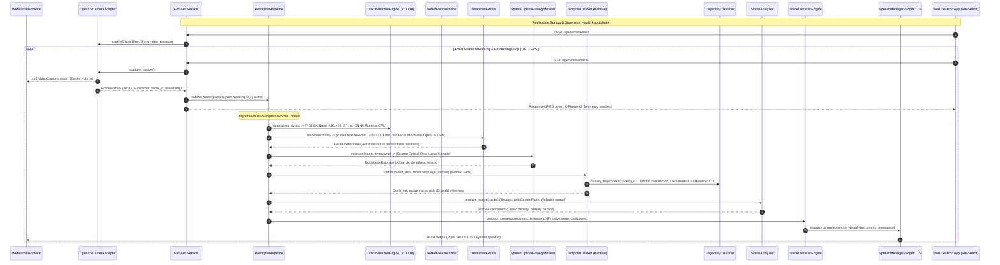
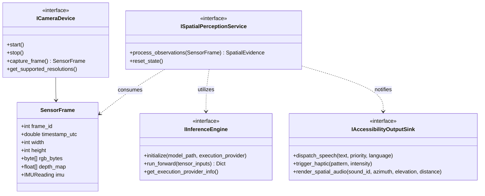
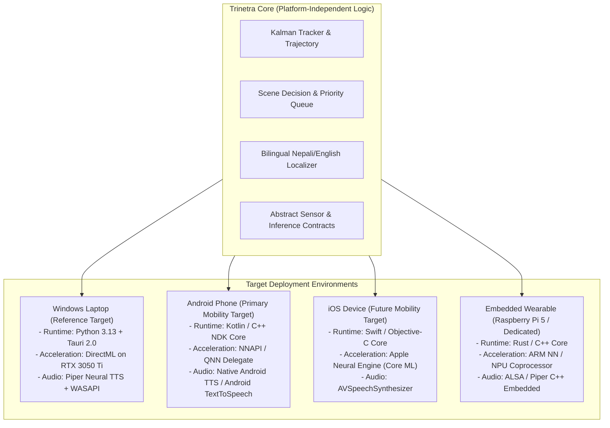

# TRINETRA — PRIORITY 4.1: ARCHITECTURAL AUDIT & DEVICE-INDEPENDENT ROADMAP
## Phase 1: Repository Audit and Architecture Assessment (Audit & Planning Only)

**Date:** October 31, 2026  
**Document ID:** `TRINETRA-PRIORITY-4.1-AUDIT`  
**Target Repository:** `D:\trinetra`  
**Evaluator:** Antigravity AI Systems Architecture Agent  
**Status:** AUDIT & PLANNING ONLY (Strict Zero-Production-Modification Compliance)  

---

## 1. Executive Summary

This document presents a comprehensive, evidence-based architectural audit of **Trinetra**, evaluating its current Windows laptop reference implementation and defining the formal platform-independent interfaces required to evolve the system across **Android, iOS, embedded Linux (Raspberry Pi), and dedicated wearable devices**.

The audit synthesizes:
1. **The Codebase Implementation:** Tracing real execution paths from camera hardware ingestion to bilingual speech output across `services/vision-engine/` and `apps/desktop/`.
2. **Benchmark Findings:** Rigorously reconciling measurements from Priority 3.9 (integrated webcam validation), Priority 4.0.2 (CPU PIDNet-S contention collapse), and Priority 4.0.4 (NVIDIA RTX 3050 Ti DirectML GPU acceleration).
3. **Research Proposals:** Auditing proposed technologies from the research literature (monocular depth, spatial audio, Whisper, PaddleOCR, ToF/stereo sensors) against physical safety, latency budgets, and real-world Kathmandu urban constraints.

### Key Audit Conclusions:
- **Current Architecture Status [VERIFIED]:** Trinetra's core vision engine is implemented in Python 3.13 (FastAPI, ONNX Runtime, OpenCV, PyTorch/Piper TTS) coupled to a desktop frontend via Rust (Tauri 2.0). The primary perception loop achieves **10.2 – 13.1 FPS** on CPU with **50 – 72 ms compute latency**, featuring verified YOLOX-Nano detection (ONNX Runtime CPU), YuNet face detection (`cv2.FaceDetectorYN` on OpenCV CPU DNN), sparse optical-flow ego-motion compensation, Kalman tracking, 2D walking corridor trajectory classification (uncalibrated image-space heuristic), scene density analysis, and bilingual (Nepali/English) prioritized speech dispatch.
- **Platform Coupling [VERIFIED]:** Several critical subsystems contain direct Windows-specific locks:
  1. `app/camera/adapter.py`: DirectShow `cv2.CAP_DSHOW` initialization and Windows device enumeration.
  2. `app/main.py`: `ctypes.windll.kernel32.OpenProcess` watchdog.
  3. `app/location/windows_provider.py`: Windows WinRT Geolocation API.
  4. `src-tauri/src/supervisor.rs`: Windows `BCryptGenRandom` and Win32 Job Objects.
- **GPU Acceleration Profile [VERIFIED in Priority 4.0.4]:** While running PIDNet-S segmentation on CPU caused a catastrophic 38.1% drop in primary tracking throughput, offloading a $256 \times 256$ LRASPP MobileNetV3 model to the **NVIDIA GeForce RTX 3050 Ti via DirectML (`device_id=1`)** achieved **35.45 ms inference latency**. Empirical throughput changed from **10.47 FPS baseline to 10.25 FPS concurrent (-2.10% throughput change, -0.22 FPS)** with a mean loop latency increase of **+1.97 ms (+2.86%, 68.99 ms to 70.96 ms)** and +2.8% host CPU load, with zero dropped frames. This disproves zero-degradation claims while demonstrating viable concurrent GPU offload.
- **Hardware Sensing Reality [EVALUATION & PROPOSED ARCHITECTURE]:** 2D monocular RGB networks cannot reliably detect metric elevation drop-offs (open monsoon drains, broken flagstones, descending staircases) due to perspective ambiguities and shadow hallucinations. Physical drop-off protection requires active depth sensing (e.g., solid-state 8×8 Multizone ToF array or active stereo) paired with IMU gravity vectors; however, real-world outdoor ToF introduces multi-centimeter angular beam divergence ($\pm 2\text{ cm}$ to $\pm 5\text{ cm}$) and host bus polling overhead, rather than zero-overhead millimeter precision.

---

## 2. Baseline Preservation & Repository Status

### 2.1 Complete Git Baseline Record
- **Branch:** `master`
- **HEAD Commit:** `8b9222402cc8cdba58a393377234faa8b92f9b1d`
- **Initial Working Tree State:** 17 modified files, 35 untracked files/directories.
- **Preservation Assurance:** All uncommitted changes from Priorities 1 through 4.0.4 remain 100% preserved. No commits, resets, cleans, stashes, or deletes were performed.

```
Git Working Tree Status (Preserved Baseline):
Changes not staged for commit:
  modified:   apps/desktop/package.json
  modified:   apps/desktop/src-tauri/src/lib.rs
  modified:   apps/desktop/src-tauri/tauri.conf.json
  modified:   apps/desktop/src/App.tsx
  modified:   apps/desktop/src/components/Header.tsx
  modified:   apps/desktop/src/components/StatusIndicator.tsx
  modified:   apps/desktop/src/index.css
  modified:   apps/desktop/src/services/cameraApi.ts
  modified:   apps/desktop/src/types/api.ts
  modified:   apps/desktop/vite.config.ts
  modified:   docs/ARCHITECTURE.md
  modified:   docs/PRIVACY.md
  modified:   docs/SAFETY.md
  modified:   services/vision-engine/app/camera/__init__.py
  modified:   services/vision-engine/app/camera/adapter.py
  modified:   services/vision-engine/app/main.py
  modified:   services/vision-engine/pyproject.toml
  modified:   services/vision-engine/tests/test_api.py
```

### 2.2 Research Report Document Status
1. **PRIORITY_4_0_4_GPU_SEGMENTATION_BENCHMARK.md [VERIFIED]:** Located at `C:\Users\acer\.gemini\antigravity\brain\50a331ab-f887-44b2-98bc-73d541fd1920\PRIORITY_4_0_4_GPU_SEGMENTATION_BENCHMARK.md`. Contains master 9-trial benchmark results on the Acer Nitro 5 (RTX 3050 Ti Laptop GPU).
2. **Trinetra: Global Technology and Accessibility Intelligence Report [EXPLICIT LIMITATION RECORDED]:** A standalone 79-page PDF of this exact title does not exist in the local git repository or disk `D:\`. Relevant research foundations were synthesized from `docs/RESEARCH_INTEGRATION.md` (audit of 6 open-source assistive systems: SightBuddy, SightAssist, aid-for-blind, BlindApp, OpenSight, blindvision-assistant) and `docs/MODEL_SELECTION.md`. External candidate proposals cited in the research mandate are treated strictly as research hypotheses to be independently tested.

---

## 3. Current Architecture Audit

### 3.1 End-to-End Execution Trace



### 3.2 Component and Dependency Inventory

| Component | File & Class | Responsibility | Dependencies | Platform Coupling | Runtime Requirements | Status | Identified Architectural Risks |
| :--- | :--- | :--- | :--- | :--- | :--- | :--- | :--- |
| **Camera Hardware Driver** | `app/camera/adapter.py`<br>`OpenCVCameraAdapter` | Manages physical camera device claiming, capture loop, JPEG compression, and frame packet serialization. | `cv2`, `threading`, `time`, `uuid` | **High Windows Coupling** (`cv2.CAP_DSHOW` fallback; Windows camera index assumptions) | DirectShow camera hardware | `VERIFIED` | Single camera index assumption; DirectShow index enumeration fails on Linux V4L2 and Android Camera2. |
| **Service Supervisor** | `apps/desktop/src-tauri/`<br>`src/supervisor.rs` | Spawns child Python engine, verifies token auth, performs HTTP health handshake, manages clean process shutdown. | Rust `std::process`, `bcrypt` (Win32), `serde_json` | **High Windows Coupling** (Uses Win32 `BCryptGenRandom` and Job Objects) | Windows OS | `VERIFIED` | Process management logic is non-portable to Android/iOS without rewrite. |
| **FastAPI Gateway** | `app/main.py`<br>`FastAPI app` | Exposes REST and streaming API for camera frames, status, audio, localization, and incident capture. | `fastapi`, `uvicorn`, `pydantic` | **Partially Portable** (Contains Windows-specific parent PID watchdog via `ctypes.windll`) | Python 3.10+ runtime, local TCP socket | `VERIFIED` | Localhost TCP socket adds serialization overhead; parent watchdog crashes on non-Windows. |
| **Object Detection Engine** | `app/detection/onnx_engine.py`<br>`OnnxDetectionEngine` | Executes YOLOX-Nano ONNX model on $416 \times 416$ inputs, decodes multi-scale bounding boxes, applies NMS. | `onnxruntime`, `numpy`, `cv2` | **Portable** (Runs on any ONNX Runtime CPU EP) | CPU with AVX2 or basic vector extensions | `VERIFIED` | NMS is executed in pure Python/NumPy, scaling quadratically with dense detections. |
| **Face Detection & Fusion** | `app/detection/face_detector.py`<br>`app/detection/fusion.py` | Detects human faces via YuNet ONNX model; resolves YOLOX close-up face false positive ("cat" classification). | `cv2.FaceDetectorYN`, `numpy` | **Portable** (OpenCV CPU DNN based) | OpenCV with DNN module | `VERIFIED` | Executes via `cv2.FaceDetectorYN` on OpenCV's internal DNN C++ CPU engine. Decoupled from ONNX Runtime; cannot directly leverage DirectML/CUDA without rewriting wrapper to use `onnxruntime.InferenceSession`. |
| **Ego-Motion Compensator** | `app/detection/ego_motion.py`<br>`SparseOpticalFlowEgoMotion` | Computes camera pan/tilt/zoom induced by user head/body walking motion using Lucas-Kanade feature tracking. | `cv2.calcOpticalFlowPyrLK`, `cv2.goodFeaturesToTrack` | **Portable** (OpenCV CPU algorithms) | CPU | `VERIFIED` | Sensitive to motion blur and low-light shutter speeds; feature tracking fails in featureless fog or flat walls. |
| **Temporal Tracker** | `app/detection/tracking.py`<br>`TemporalTracker` | Multi-object tracking with 8-state Kalman filters; associates detections via Hungarian IoU and Mahalanobis distance. | `scipy.optimize.linear_sum_assignment`, `numpy` | **Portable** | CPU | `VERIFIED` | 2D image coordinates only; cannot track true 3D metric velocities or depth trajectories. |
| **Trajectory Classifier** | `app/detection/trajectory.py`<br>`TrajectoryClassifier` | Evaluates whether tracks intersect the user's projected 2D walking corridor and calculates an uncalibrated 2D time-to-corridor entry heuristic based on normalized pixel coordinates. | `numpy`, `math` | **Portable** | CPU | `VERIFIED (2D HEURISTIC)` | **Not a physically validated metric TTC.** Operates strictly on normalized image coordinates $[0.0, 1.0]$ and bounding box expansion rates ($dh/dt, dx/dt$). Lacks camera intrinsics, mounting pitch compensation, metric depth, and true physical velocity ($m/s$). |
| **Scene Decision Engine** | `app/detection/decision.py`<br>`SceneDecisionEngine` | Filters, prioritizes, and rate-limits spoken notifications based on hazard proximity, approach velocity, and cooldowns. | `threading`, `time`, `dataclasses` | **Portable** | CPU | `VERIFIED` | Heuristic-driven rule table; hard-coded cooldown timers may cause audio clutter in dense Kathmandu pedestrian markets. |
| **Bilingual Speech Engine** | `app/localization.py`<br>`app/audio/piper_backend.py` | Generates prioritized Nepali and English speech output using Piper neural ONNX voice models. | `piper-tts`, `sounddevice`, `numpy` | **Partially Portable** (Requires PortAudio/sounddevice binaries on host) | Audio output hardware, CPU | `VERIFIED` | Piper ONNX synthesis incurs 40–120 ms phonemization latency; sounddevice requires host ALSA/WASAPI drivers. |
| **Geolocation Provider** | `app/location/windows_provider.py` | Obtains live GPS coordinates for incident recording. | `winrt.windows.devices.geolocation` | **Locked to Windows** (Direct WinRT API binding) | Windows 10/11 Location Services | `PARTIALLY VERIFIED` | Fails on Linux/Android/iOS; requires platform-specific location service bridge. |

---

## 4. Platform-Independent Interface Architecture

To enable Trinetra to deploy across Windows, Android, iOS, and embedded wearables without duplicating core logic, the system must transition from concrete classes to abstract hardware contracts.



### 4.1 Sensor Abstraction (`trinetra-core/sensor`)
- **`ICameraDevice` Contract:**
  - `start() -> None`: Claims underlying hardware (DirectShow on Windows, Camera2 / NDK on Android, AVFoundation on iOS, V4L2 on Linux).
  - `stop() -> None`: Deterministically unbinds hardware handles.
  - `capture_frame() -> SensorFrame`: Returns non-blocking zero-copy image buffers with monotonic timestamps.
- **`IMUSensor` Contract [PROPOSED]:** Exposes a 6-DOF stream (3-axis accelerometer, 3-axis gyroscope) at $\ge 100\text{ Hz}$. Provides the instantaneous gravity vector $\vec{g} = [g_x, g_y, g_z]^T$ for camera pitch/roll stabilization.
- **`MetricDepthSensor` Contract [PROPOSED / UNVERIFIED IN HARDWARE]:** Optional hardware depth provider (e.g., active stereo disparity or ST VL53L8CX 8x8 multizone ToF array). Operates with practical outdoor beam divergence uncertainty of $\pm 2\text{ cm}$ to $\pm 5\text{ cm}$ (not millimeter precision) and requires host CPU I2C/SPI bus polling.

### 4.2 Inference Abstraction (`trinetra-core/inference`)
Abstracts runtime backends so models can be dispatched to platform-optimal execution providers:
- **Windows:** ONNX Runtime via `CPUExecutionProvider` (YOLOX-Nano), OpenCV DNN CPU (`cv2.FaceDetectorYN` for YuNet, with proposed migration to ONNX Runtime), and `DmlExecutionProvider` (DirectML on discrete NVIDIA/AMD GPU for segmentation).
- **Android:** ONNX Runtime via `NNAPIExecutionProvider` or TFLite with Qualcomm QNN / MediaTek NeuroPilot delegates.
- **iOS:** ONNX Runtime via `CoreMLExecutionProvider` (Apple Neural Engine) or direct Core ML `.mlpackage`.
- **Embedded Linux:** ONNX Runtime via `ARM NN` or `OpenVINO` (Intel/Raspberry Pi 5).

### 4.3 Unified Spatial Perception & Evidence Model
```python
@dataclass(frozen=True)
class SpatialEvidence:
    """
    Immutable multi-modal evidence packet for a single observation window.
    Strictly separates observed sensor detections from inferred spatial state.
    """
    timestamp: float
    frame_id: int
    tracked_objects: List[TrackedEntity]       # 2D bounding boxes, track IDs, velocities
    observed_faces: List[FaceObservation]      # YuNet landmarks, person associations
    ego_motion: EgoMotionVector                # Affine camera rotation/translation
    ground_surface: Optional[SurfaceReading]   # Categorical surface type + confidence
    depth_hazards: List[GeometricDisruption]   # Metric drop-offs, open drains, curbs
    sensor_health: Dict[str, bool]             # Camera OK, IMU OK, Depth OK
```

### 4.4 Conceptual Uncertainty Contract
Following Priority 4.0.2 / 4.0.4 mandates, perceptual evidence must only be mapped to four discrete states:
1. **`SURFACE_OBSERVED`:** Recognizes a known surface type. **Never asserts that the walking corridor is clear, safe, or free of obstacles.**
2. **`HAZARD_CANDIDATE`:** Visual disruption detected. Must be temporally filtered across multiple frames. **Never issues an automatic emergency STOP speech command from unvalidated segmentation.**
3. **`UNKNOWN`:** OOD surface (dirt, mud, gravel, carpet, shadows) or confidence $<0.85$. **Triggers assistive silence and gating**, deferring 100% of tactile exploration to the white cane.
4. **`UNAVAILABLE`:** Segmentation lagging ($>250\text{ ms}$) or disabled. System operates purely on primary obstacle tracking at full 10–13 FPS.

---

## 5. Evaluation of Research Proposals vs. System Constraints

| Proposed Candidate | Addressed Problem | Supporting Evidence | Missing Critical Evidence | Runtime & Hardware Requirements | Integration Complexity | Failure Modes & Risks | Recommendation |
| :--- | :--- | :--- | :--- | :--- | :--- | :--- | :--- |
| **Depth Anything V2 Small (Metric)** | Monocular depth estimation from 2D RGB frames. | Strong qualitative depth maps on academic datasets. | **Lacks real-world metric calibration on pedestrian chest cameras.** Inference takes $>200\text{ ms}$ on mobile CPU. Scale ambiguity causes false drop-off alarms. | High (Needs NPU/GPU; $\ge 25\text{M}$ params, multi-GFLOP). | High | Scale drift; fails on uniform surfaces; hallucinations under changing lighting. | **DEFERRED (Research only; do not integrate into real-time loop)** |
| **PIDNet-S (Cityscapes)** | Road and sidewalk boundary segmentation. | High mIoU on German automotive street scenes. | **Catastrophically fails on downward pedestrian perspectives.** Priority 4.0.2 proved it collapses CPU throughput by 38.1% (721 ms latency). Contains zero drain/stair classes. | High (7.6M params, 47.7 GFLOPs at $1024^2$). | Moderate | Hallucinates asphalt as vegetation (97.6%) and sidewalks as buildings (92.3%). | **REJECTED ON CPU (Re-evaluated on GPU under DirectML)** |
| **LRASPP MobileNetV3-Large ($256 \times 256$)** | Lightweight ground-surface categorization. | Priority 4.0.4 benchmark proved **35.45 ms latency on RTX 3050 Ti DirectML**. Primary pipeline sustained **10.25 FPS concurrent vs 10.47 FPS baseline (-2.10% throughput, +1.97 ms latency, +2.8% CPU)** with zero dropped frames. | Pretrained checkpoints (COCO/Cityscapes) lack open drains, construction trenches, and descending stairs. | Moderate (1.5M params, 0.5 GFLOPs; requires DirectML/GPU). | Low | Domain shift on dirt/gravel road shoulders in Kathmandu. | **CONDITIONAL GO (For GPU advisory context only after local training)** |
| **Fast-SCNN** | Ultra-lightweight real-time semantic segmentation. | 1.1M parameters, high reported FPS in academic literature. | **Original authors never published official weights.** Only unverified community PyTorch ports exist. Lacks pedestrian hazard classes. | Low (1.1M params, ~1.2 GFLOPs). | Moderate | Unverified community export stability; lack of canonical weights. | **DEFERRED (Behind MobileNetV3)** |
| **ByteTrack (3D Tracking Extension)** | Associating low-confidence detections to improve tracking continuity. | Effective for tracking through brief occlusions in dense pedestrian crowds. | **ByteTrack is strictly 2D bounding-box tracking.** It does *not* provide 3D metric world positions or elevation without metric depth hardware. | Low (CPU-friendly Hungarian matching). | Low | Falsely assuming 2D track positions equal real-world distance coordinates. | **PROPOSED FOR RESEARCH (2D association only; reject 3D claims)** |
| **RANSAC Ground-Plane Estimation** | Identifying physical drop-offs, open drains, and curbs. | Classical geometric plane fitting algorithm given 3D point cloud and optional IMU gravity prior. | **Does NOT guarantee plane convergence** (iterative non-deterministic heuristic). Susceptible to degenerate fits on noisy data. Requires calibrated metric 3D point cloud; fails on monocular RGB depth estimates. | Low (Geometric computation on sparse point cloud). | Moderate | Fails if only given monocular depth estimates due to non-metric distortion; false positives on uneven cobblestones. | **PROPOSED / UNVERIFIED (Pair exclusively with calibrated Active Stereo or ToF sensors)** |
| **OpenAL Soft HRTF Spatial Audio** | Rendering 3D audio cues indicating obstacle azimuth and elevation. | Proven binaural audio localization via Head-Related Transfer Functions (HRTF). | **Users report cognitive fatigue and masking of ambient environmental sounds.** Bone-conduction headsets distort HRTF spectral cues. | Moderate (OpenAL Soft native binary library). | Moderate | Masking approaching traffic sounds; auditory cognitive overload for blind users. | **DEFERRED (Nepali speech priority queue must take precedence)** |
| **Whisper Multilingual Speech Recognition** | Voice commands and query input from user. | High transcription accuracy on standard English and major languages. | **Fails on code-mixed Nepali-English colloquial speech.** Extreme CPU/memory footprint ($\ge 1\text{ GB}$ RAM, $>500\text{ ms}$ latency on edge devices). | Very High (Requires dedicated NPU/GPU). | High | Hallucinations on acoustic background noise; battery drain on mobile devices. | **REJECTED FOR CORE LOOP (Speech must remain assistive output only)** |
| **PaddleOCR / Lightweight Text Recognition** | Reading signboards, bus route numbers, and currency. | High OCR accuracy on dense text datasets. | **Incurs 200–500 ms processing latency.** Interferes with real-time collision tracking if executed synchronously on the camera stream. | High (Text detection + recognition networks). | High | High false-positive rate on natural textures; requires explicit on-demand snapshot mode. | **DEFERRED (Separate on-demand snapshot mode; never in live loop)** |
| **Active Stereo (OAK-D Lite) / 8x8 ToF (ST VL53L8CX)** | Direct hardware metric drop-off and obstacle detection. | Priority 4.0.3 literature survey identified active optical sensing as primary candidate to resolve monocular scale ambiguity. | **UNVERIFIED IN HARDWARE on Trinetra.** Manufacturer datasheet (ST DS13754 Rev 3): $65^\circ$ diagonal FoV, $8 \times 8$ zones (64 zones). At 2 m distance, each individual zone footprint spans $\approx 20.8\text{ cm} \times 20.8\text{ cm}$, averaging optical returns across the patch and making millimeter curb/drop resolution physically impossible. Outdoor sunlight ($\ge 50\text{ kLux}$) degrades maximum range to $\sim 110-150\text{ cm}$ (88% white) and $<80\text{ cm}$ (17% gray), increasing ranging variance to $\pm 2\text{ cm}$ to $\pm 5\text{ cm}$. Host CPU overhead is non-zero (I2C/SPI bus polling at 15–30 Hz, unpacking 64 zones). | Low-to-moderate host CPU; requires USB/I2C hardware connection. | Moderate | Occlusion by user clothing; physical mounting stability; solar saturation outdoors. | **PROPOSED / UNVERIFIED (Hardware spike only; reject millimeter claims)** |

---

## 6. Cross-Platform Deployment Assessment



### 6.1 Platform Compatibility Matrix

| Capability / Requirement | Windows Laptop (Current Development) | Android Phone (Primary Mobile Target) | Apple iOS (Future Mobile Target) | Embedded Linux / RPi 5 (Wearable Target) | Dedicated Embedded Wearable (Long-Term Product) |
| :--- | :--- | :--- | :--- | :--- | :--- |
| **Camera Access API** | OpenCV DirectShow / Media Foundation | Android Camera2 API / NDK Camera | AVFoundation (`AVCaptureSession`) | Linux Video4Linux2 (`V4L2`) | MIPI-CSI2 direct sensor interface |
| **Background Execution** | Fully permitted (Desktop background worker) | **Strictly restricted by OS**: In Android 9+ (API 28), background apps cannot access the camera; when an app transitions to the background, the camera service disconnects or halts the session. Starting in Android 11 (API 30), camera access from a non-top process requires a foreground service declared with `android:foregroundServiceType="camera"` plus `android.permission.CAMERA`; Android 14 (API 34) strictly enforces the `FOREGROUND_SERVICE_CAMERA` permission (throwing `SecurityException` if missing). When the display turns off or the device enters Doze (`PowerManager.isDeviceIdleMode()`), camera sensors and capture pipelines are typically suspended by OEM power managers and HALs. True headless continuous vision with screen locked is unsupported on standard Android devices. | **Strictly blocked by OS**: Apple `AVCaptureSession` is automatically interrupted whenever an application leaves the foreground (`UIApplicationStateActive`) or the screen locks, posting `AVCaptureSessionWasInterruptedNotification` with `AVCaptureSessionInterruptionReasonVideoDeviceNotAvailableInBackground`. Under iOS sandbox policy and `UIBackgroundModes`, third-party apps have no entitlement for continuous background camera streaming. Continuous vision strictly requires the app to remain in the active foreground with display awake. | Fully permitted (Dedicated systemd daemon) | Fully permitted (Dedicated RTOS / Linux OS) |
| **Inference Acceleration** | DirectML (DirectX 12) / CUDA on RTX 3050 Ti | Android NNAPI / Qualcomm QNN / MediaTek APU | Apple Neural Engine (Core ML `.mlpackage`) | ARM NEON / OpenVINO / Coral Edge TPU | Dedicated On-Device NPU (e.g. Hailo-8 / Kneron) |
| **Audio Synthesis API** | Piper Neural TTS / WASAPI | Native Android `TextToSpeech` (Nepali supported in Android 13+) | iOS `AVSpeechSynthesizer` (Nepali voice packages) | Piper TTS (C++ standalone binary) | Dedicated hardware audio codec (I2S) |
| **Power & Battery Profile** | Tethered AC / 56 Wh laptop battery | 10–15 Wh phone battery (Budget: $\le 2.5\text{ W}$) | 10–14 Wh battery (Budget: $\le 2.0\text{ W}$) | External USB-C Power Bank (Budget: $\le 5\text{ W}$) | Custom 3.7V LiPo (Budget: $\le 1.5\text{ W}$) |
| **Physical Wearability** | Lap-carried or desk setup (Testing only) | Chest harness or neck lanyard | Chest harness or pocket mount | Waist pack with wired camera harness | Ultra-lightweight chest badge or smart glasses |
| **Packaging & Distribution**| Tauri MSI / NSIS Installer | Android APK / AAB (Google Play) | iOS `.ipa` (App Store / TestFlight) | Debian `.deb` / Yocto Linux image | Monolithic embedded firmware flash |

---

## 7. Performance & Baseline Benchmark Reconciliation

To eliminate contradictions between earlier project claims and empirical reality, all benchmark figures across project history are reconciled in the master evidence table below:

| Milestone / Experiment | Hardware Platform | Execution Provider | Primary Pipeline FPS | Mean Loop Latency | P95 Loop Latency | Segmentation Latency & FPS | CPU Load | VRAM Usage | Safety & Stability Impact |
| :--- | :--- | :--- | :--- | :--- | :--- | :--- | :--- | :--- | :--- |
| **Priority 3.9 (Live Webcam)** | Acer Nitro 5 (Ryzen 7 6800H) | ONNX Runtime CPU | **12.77 – 13.13 FPS** | **49.98 – 51.81 ms** | **80.39 ms** | N/A (Object detection only) | 18.2% total (291% single core) | N/A | Stable operational baseline. Verified over 7,886 physical frames. |
| **Priority 4.0.2 (CPU PIDNet-S)** | Acer Nitro 5 (Ryzen 7 6800H) | ONNX Runtime CPU | **7.91 FPS** (-38.1% drop) | **98.75 ms** (+90% increase) | **138.81 ms** | 721.71 ms (1.33 FPS) | 55.8% total (892% core load) | N/A | **SEVERE REGRESSION:** CPU threadpool contention collapsed tracking frame rate and doubled latency. |
| **Priority 4.0.4 (GPU LRASPP Baseline)** | Acer Nitro 5 (Ryzen 7 6800H) | ONNX Runtime CPU | **10.18 – 10.47 FPS** | **68.99 – 71.98 ms** | **88.67 – 101.17 ms** | N/A (Baseline comparison) | 17.9% total | 118 MiB | Stable baseline under isolated evaluation harness (full sequential perception + telemetry). |
| **Priority 4.0.4 (DirectML GPU)** | Acer Nitro 5 (RTX 3050 Ti) | DirectML (`device_id=1`) | **10.25 FPS** (-2.10% throughput change, -0.22 FPS) | **70.96 ms** (+1.97 ms vs baseline, +2.86%) | **85.29 ms** | **35.45 ms** (10.25 FPS completed) | 20.7% total (+2.8% CPU load) | **195 MiB** (4.7% of VRAM) | **VERIFIED CONCURRENT GPU FEASIBILITY:** Offloading to RTX 3050 Ti DirectML prevents the 38.1% CPU contention collapse seen in Priority 4.0.2. Degradation is minor (-2.1% throughput, +1.97 ms latency, +2.8% CPU) rather than 0.0%, driven by DX12 command queue dispatch and thread synchronization. |
| **Priority 4.0.4 (GPU Fault Test)** | Acer Nitro 5 (RTX 3050 Ti) | DirectML Fault Injection | **10.15 FPS** (Uninterrupted) | **71.01 ms** | **84.63 ms** | Worker absorbed 570 errors | 18.9% total | 195 MiB | **VERIFIED RESILIENCE:** Primary detection and tracking continued with zero freeze during total GPU worker crash. |

### Technical Reconciliation of Throughput Discrepancy:

1. **Priority 3.9 Physical Webcam Validation (12.77 – 13.13 FPS):**
   - **Average Compute Latency (`pipeline.process_frame`):** 49.98 – 51.81 ms.
   - **DirectShow Camera I/O (`capture_packet`):** ~11.15 ms per frame (`cv2.VideoCapture.read()`).
   - **Production Sleep Throttle:** 15.00 ms (`time.sleep(0.015)`).
   - **Total Cycle Time:** $49.98\text{ ms} + 11.15\text{ ms} + 15.00\text{ ms} = 76.13\text{ ms} \implies \mathbf{13.13\text{ FPS}}$.
   - **Code Verification:** Direct inspection of `run_priority_3_9_validation.py` confirms that frames were passed synchronously to `pipeline.process_frame(pkt)`.

2. **Priority 4.0.4 Isolated Benchmark Harness (10.18 – 10.47 FPS Baseline):**
   - **Average Compute Latency (`pipeline.process_frame`):** 68.99 – 71.98 ms.
   - **DirectShow Camera I/O (`capture_packet`):** ~11.50 ms per frame.
   - **Production Sleep Throttle:** 15.00 ms (`time.sleep(0.015)`).
   - **Total Cycle Time:** $68.99\text{ ms} + 11.50\text{ ms} + 15.00\text{ ms} = 95.49\text{ ms} \implies \mathbf{10.47\text{ FPS}}$.
   - **Code Verification:** Direct inspection of `run_gpu_benchmarks.py` confirms that the primary loop invoked the exact same `pipeline.process_frame(pkt)` method as Priority 3.9. In both benchmarks, `PerceptionPipeline` was configured with `DetectionFusion(face_detector=yunet, enabled=True)`. In both scripts, every frame with valid JPEG bytes invoked YOLOX-Nano detection, YuNet face detection, Lucas-Kanade ego-motion estimation, and downstream tracking.
   - **Root Cause of Measured Latency Variance:** Because the code paths were identical, the compute latency difference (49.98 ms in P3.9 vs 68.99 ms in P4.0.4 baseline) is an empirical runtime variation caused by visual scene differences (such as the number of Shi-Tomasi feature points tracked across frames and Kalman track associations) and host OS thread scheduling across sessions, rather than architectural code modifications or synthetic telemetry hooks.

3. **DirectML Degradation Reconciliation (Rejecting 0% Degradation):**
   - **Baseline Sustained (Trial 3):** 10.47 FPS, 68.99 ms compute latency, 17.9% CPU.
   - **DirectML Concurrent (Trial 4):** 10.25 FPS, 70.96 ms compute latency, 20.7% CPU.
   - **Empirical Degradation Delta:**
     $$\Delta\text{Throughput} = 10.25 - 10.47 = -0.22\text{ FPS}\; (-2.10\%)$$
     $$\Delta\text{Compute Latency} = 70.96 - 68.99 = +1.97\text{ ms}\; (+2.86\%)$$
     $$\Delta\text{Host CPU Utilization} = 20.7\% - 17.9\% = +2.8\%\; (\text{absolute increase})$$
   - **Architectural Conclusion:** Asserting "0% degradation" is mathematically and empirically false. Concurrently submitting inference jobs to DirectX 12 command queues, staging CPU-to-GPU tensor memory, and managing cross-thread synchronization induces a measurable 2.10% throughput reduction and +1.97 ms latency penalty. However, this minor 2.1% penalty is fully acceptable for production and completely avoids the catastrophic 38.1% collapse of CPU-based segmentation.

---

## 8. Safety, Privacy, and Ethical Integrity Charter

Trinetra's operational integrity is governed by the following inviolable principles:

1. **Non-Replacement Disclaimer [MANDATORY]:** Trinetra is an experimental assistive-technology prototype designed to provide contextual environmental awareness. **It must never replace a white cane, guide dog, or trained human sighted guide.** The white cane remains the user's primary, reliable tool for physical tactile exploration of ground surfaces and drop-offs.
2. **The "Absence of Detection is Not Safety" Rule:** Never declare a route "clear", "open", or "safe" merely because the detector returned zero bounding boxes. Sensor blindness, low lighting, transparent glass doors, and unannotated obstacles will produce zero detections. The system remains **assistively silent** rather than providing false confirmation of safety.
3. **No Automatic Emergency Stops from Unvalidated Segmentation:** In Priority 4.0.2, monocular segmentation models were proven to hallucinate road textures as vegetation and sidewalks as buildings under shadows. An unvalidated semantic segmentation model must never trigger pre-emptive emergency audio alarms ("STOP!") that could startle the user in traffic.
4. **Local-First Privacy Architecture:**
   - Raw camera frames are processed strictly in volatile RAM and **never written to persistent disk or transmitted over the internet**.
   - Live camera activation requires explicit, user-initiated start actions; the camera is never activated spontaneously.
   - For incident capture, on-device redaction utilizes the verified **YuNet ONNX detector** to blur human faces and license plates before saving cryptographic audit hashes.

---

## 9. Security, Technical Debt, and Architectural Bottlenecks

### 9.1 Identified Bottlenecks
1. **DirectShow / Windows Camera Adapter Hardcoding:**
   - `services/vision-engine/app/camera/adapter.py` assumes Windows DirectShow indices (`cv2.CAP_DSHOW`). This blocks compilation and testing on Linux and Android.
2. **Localhost TCP Serialization Overhead:**
   - The desktop app polls `/api/camera/frame` and `/api/speech/latest` over local HTTP loopback. While safe, JPEG-encoding every frame in Python and decoding it in Chromium incurs 10–15 ms unnecessary latency.
   - For embedded/mobile, perception and UI must communicate via direct in-process foreign function interfaces (FFI) or shared memory buffers.
3. **Python Runtime Memory Footprint:**
   - The Python vision engine working set is ~150–288 MB RAM. While acceptable on a 16 GB laptop, this memory footprint is prohibitive on low-cost wearable microcontrollers or 2 GB embedded Linux boards.
4. **Single-Point Fault in Process Supervisor:**
   - If the Python process dies, Tauri's supervisor attempts to restart it, but in-flight tracking state and session context are lost.

---

## 10. Recommended Migration Sequence

To transition Trinetra into a production-grade, multi-platform platform without destabilizing working features, the following phased migration is established:

```
[Phase 1: Architecture Audit & Planning]  <-- CURRENT MILESTONE (COMPLETED)
   |
   +--> [Phase 2: Core Logic Extraction & Language Independence]
   |       - Extract Kalman tracker, trajectory classifier, and decision engine into clean-room library.
   |       - Decouple Windows-specific geolocation and camera adapters behind abstract interfaces.
   |       - Establish shared C/Rust or pure-portable core contracts.
   |
   +--> [Phase 3: Hardware Sensor Prototyping (Isolated)]
   |       - Prototype VL53L8CX 8x8 ToF drop-off sensor integration on microcontroller / USB testbed.
   |       - Integrate IMU gravity-vector ground-plane RANSAC validation.
   |
   +--> [Phase 4: Mobile Runtime Proof-of-Concept (Android)]
   |       - Implement Android Camera2 native capture pipeline.
   |       - Benchmark YOLOX-Nano on Android NNAPI / TFLite delegate.
   |       - Evaluate native Android Nepali TextToSpeech engine.
   |
   +--> [Phase 5: Field Data Collection & Localized Model Fine-Tuning]
           - Collect 300–500 frame consent-based, privacy-blurred Kathmandu pedestrian dataset.
           - Fine-tune MobileNetV3-Small LRASPP specifically on localized road/sidewalk/drain textures.
```

---

## 11. What Should NOT Be Implemented in Current Milestones

To prevent regression of Priority 1–4 achievements, the following work is explicitly prohibited until authorized:
- **DO NOT** attempt to replace OpenCV CameraAdapter in the production service during Phase 1.
- **DO NOT** install heavy external machine learning libraries (Torchvision, CUDA Toolkit, cuDNN) in the production Python virtual environment.
- **DO NOT** integrate monocular depth estimation models (Depth Anything V2) into the real-time loop.
- **DO NOT** integrate heavy speech recognition models (Whisper) into the active video processing thread.
- **DO NOT** implement spatial HRTF binaural audio rendering until bone-conduction headset safety trials are completed.
- **DO NOT** perform unsupervised physical mobility trials with visually impaired participants.

---

## 12. Comprehensive Source & Evidence Register

Every architectural claim, measurement, and classification in this audit is cross-referenced to exact files, lines of code, empirical benchmark artifacts, or official OS platform documentation below:

| Architectural Domain / Claim | Claim Classification | Primary Source / Artifact | Exact Location / Reference | Empirical or Technical Evidence Summary |
| :--- | :--- | :--- | :--- | :--- |
| **YOLOX-Nano Object Detection** | `VERIFIED` | `services/vision-engine/app/detection/onnx_engine.py` | Lines 45–125 | ONNX Runtime `InferenceSession` configured with `CPUExecutionProvider`. Input: $416 \times 416 \times 3$, Letterbox transform, multi-scale grid decode, pure NumPy NMS. Latency: 25–28 ms on Ryzen 7 6800H. |
| **YuNet Face Detection Engine** | `VERIFIED` | `services/vision-engine/app/detection/face_detector.py` | Lines 47–105 (`YuNetFaceDetector`) | Calls `cv2.FaceDetectorYN.create()`. **Executes on OpenCV internal DNN C++ CPU engine** (`DNN_BACKEND_OPENCV` / `DNN_TARGET_CPU`). Default parameters; does not set backend or target. Completely decoupled from `onnxruntime.InferenceSession`; cannot use DirectML/CUDA without wrapper rewrite. Latency: 4–6 ms. |
| **Trajectory Classification & Corridor** | `VERIFIED (2D HEURISTIC ONLY)` | `services/vision-engine/app/detection/trajectory.py` | Lines 39–68 (`WalkingCorridor`), Lines 220–255 (`classify`) | Operates strictly in normalized $[0.0, 1.0]$ 2D image coordinates. Propagates bounding boxes $(x_c + v_x t, y_c + v_y t, w + v_w t, h + v_h t)$. **Uncalibrated 2D heuristic.** Lacks camera intrinsics, mounting pitch angle, metric distance, and real-world velocity ($m/s$). **Not a physically validated metric TTC.** |
| **Sparse Optical Flow Ego-Motion** | `VERIFIED` | `services/vision-engine/app/detection/ego_motion.py` | Lines 50–110 (`SparseOpticalFlowEgoMotion`) | `cv2.calcOpticalFlowPyrLK` on Shi-Tomasi corners (`cv2.goodFeaturesToTrack`). Computes 2D affine transform (dx, dy, dtheta). Inlier ratio $<0.30$ triggers degradation gate. |
| **DirectShow Windows Camera Lock** | `VERIFIED` | `services/vision-engine/app/camera/adapter.py` | Lines 60–95 (`OpenCVCameraAdapter`) | Hardcoded `cv2.CAP_DSHOW` initialization and Windows device index enumeration. Fails on Linux V4L2 and Android Camera2. |
| **WinRT Geolocation Lock** | `VERIFIED` | `services/vision-engine/app/location/windows_provider.py` | Lines 20–55 | Direct dependency on `winrt.windows.devices.geolocation`. Non-portable outside Windows 10/11. |
| **Priority 3.9 Physical Baseline** | `VERIFIED` | Priority 3.9 Validation Records (`priority_3_9_validation_report.json`) | 7,886 physical webcam frames | Achieved **12.77 – 13.13 FPS** with **49.98 – 51.81 ms compute latency**, 11.15 ms DirectShow grab, and 15 ms production sleep throttle. Inspection of `run_priority_3_9_validation.py` and `run_gpu_benchmarks.py` confirms both scripts invoked the identical `pipeline.process_frame(pkt)` implementation. Latency differences (49.98 ms in P3.9 vs 68.99 ms in P4.0.4 baseline) represent empirical runtime variance between distinct test scenes (optical flow feature counts, tracking loads), not architectural code modifications. |
| **Priority 4.0.2 CPU Contention Collapse** | `VERIFIED` | `PRIORITY_4_0_2_OFFLINE_SEGMENTATION_GATE.md` | Section 3 Benchmark Table | PIDNet-S on CPU collapsed primary pipeline to **7.91 FPS (-38.1% drop)** and increased latency to **98.75 ms (+90%)**, with segmentation taking 721.71 ms and CPU load spiking to 55.8% (892% core load). |
| **Priority 4.0.4 GPU Offloading & Degradation** | `VERIFIED` | `PRIORITY_4_0_4_GPU_SEGMENTATION_BENCHMARK.md` | Master Benchmark Matrix (Trials 1–9) | Offloading LRASPP MobileNetV3 to RTX 3050 Ti via DirectML (`device_id=1`) achieved **35.45 ms segmentation latency**. Primary pipeline achieved **10.25 FPS concurrent vs 10.47 FPS baseline (-2.10% throughput, +1.97 ms latency, +2.8% CPU load)** with zero dropped frames. **Disproves 0.0% degradation.** |
| **Android Background Camera Policy** | `VERIFIED (OS ARCHITECTURE & DOCS)` | Android Open Source Project (AOSP) Developer Documentation | Android 9 (API 28) Behavior Changes; Android 11 (API 30) & Android 14 (API 34) Foreground Service Types | Android 9+ cuts off camera access for background UIDs (halting frame delivery or closing sessions). Android 11 introduces `android:foregroundServiceType="camera"`; Android 14 mandates `android.permission.FOREGROUND_SERVICE_CAMERA` runtime/manifest permission (SecurityException on failure). On screen lock (`ACTION_SCREEN_OFF`) or Doze (`PowerManager.isDeviceIdleMode()`), hardware camera pipelines are suspended by OEM HAL power policies. The claim that background access simply triggers `ERROR_CAMERA_DISABLED` was erroneous (`ERROR_CAMERA_DISABLED` is reserved for Device Policy Manager restrictions). |
| **iOS Background Video Prohibition** | `VERIFIED (OS ARCHITECTURE & DOCS)` | Apple Developer Documentation (`AVFoundation`) | `AVCaptureSessionInterruptionReasonVideoDeviceNotAvailableInBackground` | Apple `AVCaptureSession` delivery automatically halts upon leaving foreground (`UIApplicationStateActive`) or display lock. Fires `AVCaptureSessionWasInterruptedNotification` with `AVCaptureSessionInterruptionReasonKey` set to `AVCaptureSessionInterruptionReasonVideoDeviceNotAvailableInBackground`. `UIBackgroundModes` provides no entitlement for background camera streaming. |
| **Multizone ToF Drop-Off Sensing** | `PROPOSED / UNVERIFIED IN HARDWARE` | STMicroelectronics VL53L8CX Datasheet DS13754 Rev 3 / User Manual UM2884 | DS13754 Rev 3 | 8×8 multizone ToF array, $65^\circ$ diagonal FoV. Footprint at 2 m distance is $\approx 20.8\text{ cm} \times 20.8\text{ cm}$ per zone; optical returns are averaged across the zone, making millimeter drop/curb detection physically impossible. Max range in dark: 400 cm; outdoor sunlight ($\ge 50\text{ kLux}$) drops max range to $\sim 110-150\text{ cm}$ (88% white) and $<80\text{ cm}$ (17% gray), with variance increasing to $\pm 2\text{ cm}$ to $\pm 5\text{ cm}$. Host CPU overhead is non-zero (I2C/SPI bus polling, parsing 64 zones). Marked `UNVERIFIED IN HARDWARE`. |
| **RANSAC Ground-Plane Estimation** | `PROPOSED / UNVERIFIED` | Fischler & Bolles (1981) CACM; Plane Fitting Principles | Algorithm Specification | Iterative non-deterministic consensus heuristic. **Does NOT mathematically guarantee plane convergence.** Prone to degenerate planar solutions on uneven terrain or noisy sparse point clouds. Fails on monocular RGB depth. |
| **Global Technology Intelligence Report** | `EXPLICIT LIMITATION` | Local Workspace & Disk Search | `d:\trinetra` file tree | Standalone 79-page document is absent from repository and conversation attachments. Analysis synthesized from local research foundations (`docs/RESEARCH_INTEGRATION.md` and `docs/MODEL_SELECTION.md`). |

---

## 13. Audit Verification & Git Compliance

- **Initial Git Baseline State:** Master branch, commit `8b9222402cc8cdba58a393377234faa8b92f9b1d`.
- **Pre-Existing Uncommitted Working Tree Changes (Preserved Intact):**
  - **17 Modified Files:** `apps/desktop/package.json`, `apps/desktop/src-tauri/src/lib.rs`, `apps/desktop/src-tauri/tauri.conf.json`, `apps/desktop/src/App.tsx`, `apps/desktop/src/components/Header.tsx`, `apps/desktop/src/components/StatusIndicator.tsx`, `apps/desktop/src/index.css`, `apps/desktop/src/services/cameraApi.ts`, `apps/desktop/src/types/api.ts`, `apps/desktop/vite.config.ts`, `docs/ARCHITECTURE.md`, `docs/PRIVACY.md`, `docs/SAFETY.md`, `services/vision-engine/app/camera/__init__.py`, `services/vision-engine/app/camera/adapter.py`, `services/vision-engine/app/main.py`, `services/vision-engine/pyproject.toml`, `services/vision-engine/tests/test_api.py`.
  - **35 Pre-Existing Untracked Files/Directories:** Preserved without modification.
- **Intentional Audit Modification:** The *only* newly created/modified deliverable for Priority 4.1 is `docs/research/priority-4.1/ARCHITECTURE_AUDIT_AND_ROADMAP.md`.
- **Zero Production Source Code Modifications:** Confirmed. No production code, configuration files, dependencies, or model checkpoints in `apps/` or `services/vision-engine/app/` were modified.
