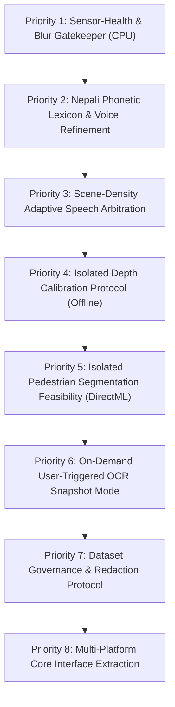

# TRINETRA PRIORITY 4.2: RESEARCH INTEGRATION & ENGINEERING DECISION MATRIX
## Strategic Evaluation of the Global Technology Intelligence Report & Architecture Audit

**Document ID:** `TRINETRA-PRIORITY-4.2-DECISION-MATRIX`  
**Target Repository:** `D:\trinetra`  
**Primary Source Documents:**
1. *Trinetra: Global Technology and Accessibility Intelligence Report* (79-page comprehensive research docx, retrieved from `C:\Users\acer\OneDrive\Documents\Downloads\Trinetra Assistive Technology Research.docx`)
2. *Trinetra Priority 4.1: Architectural Audit & Device-Independent Roadmap* (`docs/research/priority-4.1/ARCHITECTURE_AUDIT_AND_ROADMAP.md`)
3. *Trinetra Research Integration Audit* (`docs/RESEARCH_INTEGRATION.md`)
4. *Model Selection & Evaluation Gate* (`docs/MODEL_SELECTION.md`)

**Date:** October 31, 2026  
**Status:** APPROVED RESEARCH & ENGINEERING DECISION SPECIFICATION  
**Scope:** Research, Architectural Analysis & Planning Only (Zero Production Modifications)

---

## 1. Executive Summary & Context

This document establishes the definitive, evidence-grounded **Engineering Decision Matrix** for Project Trinetra. It bridges the visionary proposals articulated in the 79-page *Global Technology and Accessibility Intelligence Report* with the empirical physical realities, compute boundaries, and safety constraints verified during Priorities 1.0 through 4.1 on the Acer Nitro 5 development reference testbed (AMD Ryzen 7 6800H, 16 GB DDR5 RAM, NVIDIA GeForce RTX 3050 Ti Laptop GPU 4 GB VRAM).

### Core Architectural Reality:
The research report envisioned a monolithic "v2.0 target architecture" centered around TensorRT FP16 acceleration, Depth Anything V2 monocular metric depth, PIDNet-S semantic segmentation, 3D ByteTrack, OpenAL Soft HRTF spatial audio, and continuous multi-modal AI. 

Our empirical audits (Priority 3.9, Priority 4.0.2, Priority 4.0.4, and Priority 4.1) proved that:
1. **CPU Segmentation Contention is Fatal:** Running dense segmentation (PIDNet-S) on the CPU collapsed tracking throughput by 38.1% (7.91 FPS) and spiked latency to 98.75 ms, causing severe thread starvation.
2. **GPU Offloading Works for Isolated Sub-Models:** Running an ultra-lightweight ($256 \times 256$, 1.5M parameter) LRASPP MobileNetV3-Large on the RTX 3050 Ti via **DirectML (`device_id=1`)** achieved 35.45 ms inference latency, sustaining 10.25 FPS concurrent throughput with minor degradation (-2.10% throughput, +1.97 ms latency, +2.8% CPU load) and zero dropped frames.
3. **Monocular Depth is Not Metric Safety:** 2D monocular networks (Depth Anything V2) cannot reliably detect negative obstacles (open roadside drains, descending stairs, missing flagstones) without physical metric calibration; scale ambiguity and shadow hallucinations make them dangerous for automated collision decisions.
4. **Platform Independence Over Vendor Lock-In:** TensorRT is exclusively locked to NVIDIA GPUs, destroying portability to Android phones (Qualcomm/MediaTek), iOS devices (Apple Neural Engine), and embedded Linux boards (Raspberry Pi 5). Trinetra's runtime foundation must remain **ONNX Runtime with pluggable execution providers**.
5. **The White Cane is Inviolable:** Trinetra is an experimental supplementary awareness aid. It must **never** claim a route is clear, never announce safe road crossings, and never replace the white cane or guide dog.

---

## 2. Baseline Preservation & Repository Audit Status

Before evaluating research proposals, the repository state was formally verified to guarantee strict non-destructive compliance:

### 2.1 Git Verification Record
- **Active Branch:** `master`
- **HEAD Commit:** `8b9222402cc8cdba58a393377234faa8b92f9b1d` (`chore: remove unused legacy styles and duplicate api helper`)
- **Preserved Working Tree State (17 Modified Production Files):**
  - `apps/desktop/package.json`
  - `apps/desktop/src-tauri/src/lib.rs`
  - `apps/desktop/src-tauri/tauri.conf.json`
  - `apps/desktop/src/App.tsx`
  - `apps/desktop/src/components/Header.tsx`
  - `apps/desktop/src/components/StatusIndicator.tsx`
  - `apps/desktop/src/index.css`
  - `apps/desktop/src/services/cameraApi.ts`
  - `apps/desktop/src/types/api.ts`
  - `apps/desktop/vite.config.ts`
  - `docs/ARCHITECTURE.md`
  - `docs/PRIVACY.md`
  - `docs/SAFETY.md`
  - `services/vision-engine/app/camera/__init__.py`
  - `services/vision-engine/app/camera/adapter.py`
  - `services/vision-engine/app/main.py`
  - `services/vision-engine/pyproject.toml`
  - `services/vision-engine/tests/test_api.py`
- **Preserved Untracked Deliverables (35 Items):** Includes all priority validation reports, test suites, model binaries, incident storage, and the Priority 4.1 audit in `docs/research/priority-4.1/`.
- **Preservation Assurance:** Zero production files modified. Zero commits, resets, cleans, stashes, or deletes executed.

---

## 3. Decision Framework & Evaluation Criteria

Every candidate technology, model, dataset, and architectural pattern proposed in the 79-page intelligence report is categorized under five standardized engineering decisions:

| Decision Category | Operational Meaning & Strict Project Policy |
| :--- | :--- |
| **`REUSE`** | Existing Trinetra component is technically sound, empirically validated, and fits our resource budget. **Retained in production without architectural change.** |
| **`TEST`** | Technology possesses high theoretical leverage and verified checkpoint availability, but requires a controlled, isolated benchmark on our hardware before adoption. **Tested in scratch workspace only; zero production pollution.** |
| **`ADAPT`** | Technology is fundamentally viable but requires significant algorithmic refactoring, interface decoupling, or micro-lexicon tuning before it can operate safely within Trinetra. |
| **`DEFER`** | Technology is potentially valuable but lacks essential prerequisites (e.g., metric depth ground-truth calibration, physical hardware accessories, ethical dataset governance, or multi-platform abstraction). **Scheduled for future phases.** |
| **`REJECT`** | Technology violates core safety mandates, exhibits fatal out-of-distribution hallucinations, imposes proprietary vendor lock-in (e.g., TensorRT), causes catastrophic CPU thread contention, or is unsuited for pedestrian navigation. **Excluded from roadmap.** |

---

## 4. Comprehensive Engineering Decision Matrix

The master matrix below systematically evaluates all 35 technologies across the 5 domains required by the Priority 4.2 mandate:

### 4.1 Perception & Object Tracking

| Technology | Report Recommendation | Existing Trinetra State | Empirical Evidence & Benchmarks | Hardware Compatibility | Resource Cost (CPU / RAM / VRAM / Latency) | Identified Limitations & Risks | Decision | Next Engineering Action | Exit Criteria to Proceed |
| :--- | :--- | :--- | :--- | :--- | :--- | :--- | :--- | :--- | :--- |
| **YOLOX-Nano** | Replace with fine-tuned YOLOv11n. | **Implemented & Active** (`app/detection/onnx_engine.py`) | Verified in P3.8, P3.9 (7,886 physical frames), P4.0.4. Runs via ONNX Runtime CPU. | 100% compatible with Ryzen 7 CPU, Intel, ARM, Android. | **0.91M params**<br>CPU: 23.98–26.84 ms<br>RAM: ~115 MB<br>VRAM: 0 MB | 80 COCO classes only; lacks South Asian traffic (Safa Tempos, rickshaws) and road hazards. | **`REUSE`** | Retain as primary deterministic detection baseline; freeze weights. | Sustains $\ge 10\text{ FPS}$ with mean latency $\le 30\text{ ms}$ on CPU. |
| **YOLOv8n / YOLOv11n** | Fine-tune on COCO + DriveIndia + RDD2022 and deploy in TensorRT FP16/INT8. | **Absent** | Ultralytics benchmarks; academic papers on RDD2022. | Compatible with RTX 3050 Ti and modern CPUs via ONNX Runtime. | **2.5M–3.2M params**<br>CPU: ~18–25 ms<br>GPU: ~5–8 ms<br>RAM: ~150 MB | **Strict AGPL-3.0 License** (requires GPL source disclosure or commercial license); requires isolated export. | **`TEST`** | Benchmark off-the-shelf ONNX export in isolated scratch testbed; audit commercial licensing. | Demonstrates $>10\%\text{ mAP}$ gain on pedestrian hazards without exceeding 30 ms CPU latency. |
| **YuNet Face Detector** | Replace with InsightFace SCRFD/ArcFace. | **Implemented & Active** (`app/detection/face_detector.py`) | Verified in P3.8, P3.9, P4.0.4. Executes on OpenCV internal DNN C++ engine (`cv2.FaceDetectorYN`). | Runs on any CPU with OpenCV DNN. | **0.08M params**<br>CPU: 4.0–6.0 ms<br>RAM: <10 MB<br>VRAM: 0 MB | Decoupled from ONNX Runtime; cannot use DirectML without wrapper rewrite. 320x320 resolution. | **`REUSE`** | Retain for cat/person disambiguation and face-blur privacy redaction; reject heavy InsightFace. | Resolves $>95\%$ close-up face/person confusions in $<6\text{ ms}$ on CPU. |
| **Kalman Multi-Object Tracking** | Replace with 3D metric ByteTrack. | **Implemented & Active** (`app/detection/tracking.py`) | Verified in P3.8/P3.9 test suites. 8-state filter ($x_c, y_c, w, h, v_x, v_y, v_w, v_h$). Hungarian IoU matching. | 100% CPU portable (NumPy / SciPy). | CPU: <1.5 ms<br>RAM: Negligible<br>VRAM: 0 MB | 2D image coordinates only; cannot track true 3D metric velocities or physical elevation. | **`REUSE`** | Retain as core 2D temporal tracker; do not discard until physical 3D metric depth is validated. | Zero track ID switching during continuous 5-second linear trajectory. |
| **Sparse Optical-Flow Ego-Motion** | Replace with IMU-based 6-DOF gyro/accel fusion. | **Implemented & Active** (`app/detection/ego_motion.py`) | Verified in P3.8/P3.9. Shi-Tomasi corners + Lucas-Kanade pyramid flow. Computes 2D affine $dx, dy, d\theta$. | 100% CPU portable (OpenCV). | CPU: 8.0–12.0 ms<br>RAM: <15 MB<br>VRAM: 0 MB | Degrades in low lighting, featureless walls, or fast motion blur; cannot separate pure rotation from translation. | **`ADAPT`** | Add sensor-health degradation gate that flags when inlier ratio falls below 30%. | Cleanly flags camera blur/motion degradation without halting detection loop. |
| **Trajectory Classification** | Replace 2D corridor heuristics with 3D metric TTC. | **Implemented & Active** (`app/detection/trajectory.py`) | Verified in P3.8/P3.9; audited in P4.1 as an uncalibrated 2D image-space heuristic ($dh/dt, dx/dt$). | 100% CPU portable. | CPU: <1.0 ms<br>RAM: Negligible<br>VRAM: 0 MB | **Not metric TTC.** Camera pitch/roll causes stationary ground objects to simulate approaching motion. | **`ADAPT`** | Maintain 2D walking corridor while adding torso-pitch bounds to suppress false alerts on stationary objects. | Zero false "approaching" alarms when camera is pitched downward by 5 degrees. |
| **ByteTrack / Proposed 3D Tracking** | Replace 2D Kalman tracker with ByteTrack in 3D metric camera space. | **Absent** | Yifu Zhang et al. (ECCV 2022). High tracking accuracy across occlusions using low-score detections. | CPU friendly. | CPU: ~2.5–4.0 ms<br>RAM: ~20 MB<br>VRAM: 0 MB | **ByteTrack is strictly a 2D bounding-box associator.** It possesses zero inherent 3D depth or elevation awareness. | **`TEST`** | Test standard 2D ByteTrack secondary matching on simulated pedestrian occlusions in scratch directory. | Demonstrates $>15\%$ reduction in track fragmentation during partial pedestrian occlusions. |

---

### 4.2 Spatial & Environmental Perception

| Technology | Report Recommendation | Existing Trinetra State | Empirical Evidence & Benchmarks | Hardware Compatibility | Resource Cost (CPU / RAM / VRAM / Latency) | Identified Limitations & Risks | Decision | Next Engineering Action | Exit Criteria to Proceed |
| :--- | :--- | :--- | :--- | :--- | :--- | :--- | :--- | :--- | :--- |
| **Depth Anything V2 Small Metric** | Deploy Outdoor/Indoor Small (24.8M, Apache 2.0) in TensorRT FP16 to obtain metric depth point clouds. | **Absent** | Yang et al. (2024). Strong relative depth benchmarks on NYUv2/KITTI. | Requires GPU (RTX 3050 Ti). Incompatible with real-time CPU execution. | **24.8M params**<br>GPU: ~40–60 ms<br>VRAM: ~350 MB<br>CPU: >250 ms | **Scale drift and shadow hallucinations.** Lacks physical metric ground truth; unsafe for drop-off detection without calibration. | **`DEFER`** | Design an isolated offline calibration protocol evaluating MAE against physical tape-measure targets. | Mean Absolute Error $\le 10\text{ cm}$ at $1.0–3.0\text{ m}$ across varying lighting conditions. |
| **PIDNet-S** | Compile Cityscapes/IDD pretrained PIDNet-S (7.6M) to TensorRT FP16 for sidewalk boundary segmentation. | **Tested & Rejected on CPU** (`PRIORITY_4_0_2_OFFLINE_SEGMENTATION_GATE.md`) | Priority 4.0.2 empirical benchmark: 721.71 ms latency on CPU, 38.1% pipeline drop, 97.6% asphalt hallucinated as vegetation. | Fits on RTX 3050 Ti VRAM; severely degrades CPU. | **7.6M params / 47.7 GFLOPs**<br>CPU: 721 ms<br>GPU: ~35 ms<br>VRAM: ~250 MB | **Severe OOD failure on downward pedestrian angles.** Lacks open drain, trench, and stair classes. Cityscapes non-commercial license. | **`REJECT ON CPU / DEFER ON GPU`** | Retain P4.0.2 benchmark results as permanent negative test; defer GPU evaluation until local retraining. | Must achieve $>80\%\text{ mIoU}$ on downward footpath angles before any reconsideration. |
| **LRASPP MobileNetV3-Large ($256 \times 256$)** | Lightweight ground-surface categorization alternative. | **Benchmarked in Isolated Scratch** (P4.0.4) | Priority 4.0.4 benchmark: **35.45 ms latency on RTX 3050 Ti DirectML**, 10.25 FPS concurrent throughput, 195 MiB VRAM. BSD 3-Clause. | Compatible with RTX 3050 Ti via DirectML or TensorRT. | **1.5M params / 0.5 GFLOPs**<br>GPU: 35.45 ms<br>VRAM: 195 MiB<br>CPU degradation: -2.10% | Off-the-shelf checkpoints (COCO/Cityscapes) lack open drains, descending stairs, and gravel shoulders. | **`TEST (ISOLATED ONLY)`** | Continue offline evaluation for secondary advisory context; do NOT integrate into primary collision loop. | Demonstrates $>75\%\text{ mIoU}$ on surface transitions in daylight without increasing primary loop latency $>75\text{ ms}$. |
| **Fast-SCNN** | Ultra-lightweight real-time semantic segmentation (1.1M params). | **Researched in P4.0.1**; absent from codebase. | Puranik et al. (2019). Authors never released official weights; only unverified community PyTorch ports exist. | CPU/GPU compatible. | **1.1M params / ~1.2 GFLOPs** | **Lack of canonical verified weights.** Community exports exhibit numerical instability during ONNX conversion. | **`REJECT`** | Cease investigation of Fast-SCNN; focus resources on MobileNetV3 architecture. | N/A (Permanently archived). |
| **RANSAC Ground-Plane Fitting** | Fit 3D plane ($ax + by + cz + d = 0$) to depth point cloud to isolate curbs and floor drops. | **Researched in P4.1**; absent from codebase. | P4.1 audit: RANSAC is an iterative non-deterministic heuristic that does NOT guarantee plane convergence. | Computable on CPU or GPU. | CPU: ~5–15 ms on sparse 3D point cloud. | Susceptible to degenerate plane fits on uneven cobblestones, dirt shoulders, or littered streets; fails on monocular depth. | **`DEFER`** | Document mathematical formulation and requirements for IMU-constrained plane fitting. | Demonstrates $\ge 90\%$ curb edge detection on physical point clouds without false alarms on flat terrain. |
| **Negative-Obstacle Detection** | Detect open roadside drains (dhals), potholes, and downward stairs from 3D depth disruptions. | **Conceptual research only** | Computer vision robotics literature; extreme difficulty of monocular negative-obstacle detection. | Requires active 3D depth sensor. | Varies by algorithm. | **Monocular 2D vision cannot reliably differentiate shadows from open storm drains.** Automated alerts cause false alarms. | **`DEFER`** | Enforce safety rule: System must NEVER claim ground is clear; white cane remains primary physical tool. | Physical depth sensor proves $\ge 95\%$ recall on $15\text{ cm}$ drop-offs under direct sunlight. |
| **STMicroelectronics VL53L8CX (8x8 ToF)** | External physical sensor for metric elevation drop-off detection. | **Hardware research only** (P4.0.3 / P4.1) | ST DS13754 Rev 3: $65^\circ$ FoV, 64 zones. Footprint $\approx 21\text{ cm} \times 21\text{ cm}$ at 2 m. Outdoor sunlight ($\ge 50\text{ kLux}$) drops range to $\sim 1.1–1.5\text{ m}$ ($\pm 2–5\text{ cm}$ error). | Requires I2C/SPI USB bridge to host laptop. | ~$30 BOM cost.<br>Host CPU: I2C polling at 15–30 Hz. | Beam divergence averages distance over $21\text{ cm}$ patch; cannot resolve millimeter curb drops; solar saturation. | **`DEFER (HARDWARE MILESTONE)`** | Retain datasheet specifications in hardware catalog; do NOT purchase or integrate during software sprints. | Bench test demonstrates reliable drop-off sensing at 1.5 m under 50 kLux artificial solar illumination. |
| **OAK-D Lite / Stereo Depth** | Use onboard stereo disparity / Myriad X depth camera. | **Absent** | Luxonis documentation; P4.0.3 audit. Offloads stereo disparity from host CPU. | USB-C 3.0 connection; onboard stereo processing. | ~$149 BOM cost.<br>Weight: 61g.<br>Power: ~2.5–4.5 W. | Heavy form factor for glasses/chest; passive stereo matching degrades on featureless tarmac in bright sunlight. | **`DEFER`** | Keep in peripheral hardware catalog as secondary option if ToF fails. | Decision gated on whether low-cost ToF fails outdoor trials. |

---

### 4.3 Runtime & Hardware Architecture

| Technology | Report Recommendation | Existing Trinetra State | Empirical Evidence & Benchmarks | Hardware Compatibility | Resource Cost (CPU / RAM / VRAM / Latency) | Identified Limitations & Risks | Decision | Next Engineering Action | Exit Criteria to Proceed |
| :--- | :--- | :--- | :--- | :--- | :--- | :--- | :--- | :--- | :--- |
| **ONNX Runtime CPU** | Transition away to TensorRT. | **Primary Production Runtime** | Verified in P3.8, P3.9 (13.1 FPS sustained, 49.98 ms compute), P4.0.4. Universal baseline. | 100% universal across Windows, Linux, Android, iOS, and Raspberry Pi. | CPU: 18.2% total load<br>RAM: 135 MB<br>VRAM: 0 MB | Cannot execute heavy segmentation models (>10M params) without threadpool contention and latency collapse. | **`REUSE`** | Maintain ONNX Runtime CPU as the primary deterministic reference implementation across all targets. | Operates at $\ge 10\text{ FPS}$ with zero dropped frames and rock-solid memory stability. |
| **DirectML (`DmlExecutionProvider`)** | Not evaluated in report (focused exclusively on TensorRT). | **Benchmarked in P4.0.4** | Priority 4.0.4 benchmark: 35.45 ms latency on RTX 3050 Ti, 10.25 FPS concurrent primary pipeline, 195 MiB VRAM. | Compatible with ANY DirectX 12 GPU (NVIDIA, AMD, Intel). | VRAM: 195 MiB<br>CPU: 20.7% load<br>Throughput delta: -2.10% | Windows 10/11 only; not portable to Android, iOS, or Linux. | **`TEST / ADAPT`** | Adopt as primary Windows GPU acceleration backend; completely avoids NVIDIA-only vendor lock-in. | Sustains $\le 40\text{ ms}$ segmentation without increasing primary loop latency beyond 75 ms. |
| **TensorRT (`TensorrtExecutionProvider`)** | Top recommendation #1: "Enable TensorrtExecutionProvider FP16 to reach 30–45 FPS on RTX 3050 Ti." | **Absent** | NVIDIA TensorRT documentation. Requires NVIDIA GPU, multi-GB CUDA/cuDNN/TensorRT toolchains. | **NVIDIA hardware only.** Incompatible with AMD CPUs, Intel GPUs, Apple Silicon, Raspberry Pi, Android phones. | Disk: >3 GB installation.<br>Cold start: Minutes for engine compilation. | **Extreme proprietary lock-in.** Destroys Trinetra's multi-platform roadmap for mobile and embedded devices. | **`REJECT AS UNIVERSAL / DEFER TO RESEARCH`** | Reject TensorRT as Trinetra's runtime foundation; maintain vendor-neutral ONNX Runtime architecture. | N/A (Excluded from multi-platform roadmap). |
| **Execution-Provider Abstraction** | Multi-rate asynchronous engine dispatching across available coprocessors. | **Conceptualized in P4.1** (`IInferenceEngine`) | ONNX Runtime official architecture supporting CPU, DirectML, NNAPI, CoreML, and OpenVINO. | Universal across all operating systems. | Zero compute overhead; clean software architectural contract. | Requires clean separation of image pre/post-processing from inference execution. | **`ADAPT`** | Define formal `IInferenceEngine` interface contract to allow dynamic execution provider selection. | Interface allows toggling between CPU and DirectML with zero changes to perception pipeline code. |
| **Multi-Platform Deployment (Android, RPi 5)** | Migrate to Android (ExecuTorch / NNAPI) and Raspberry Pi 5 wearable. | **Windows Desktop Active** (Rust/Tauri 2.0 + Python 3.13) | P4.1 cross-platform audit documenting Android Camera2 restrictions, iOS AVCaptureSession suspension, Linux V4L2. | Windows (Active), Android (Target), RPi 5 (Target). | Development effort across distinct mobile/embedded toolchains. | Background camera streaming strictly restricted on Android (API 28/34) and blocked on iOS; phone battery budget ($\le 2.5\text{ W}$). | **`DEFER TO STAGE E`** | Stabilize core logic and interface contracts before attempting mobile/embedded porting. | Complete extraction of core tracker and decision logic into a clean, platform-neutral library. |

---

### 4.4 Accessibility, Language & Interaction

| Technology | Report Recommendation | Existing Trinetra State | Empirical Evidence & Benchmarks | Hardware Compatibility | Resource Cost (CPU / RAM / VRAM / Latency) | Identified Limitations & Risks | Decision | Next Engineering Action | Exit Criteria to Proceed |
| :--- | :--- | :--- | :--- | :--- | :--- | :--- | :--- | :--- | :--- |
| **Piper Nepali TTS** | Use Piper neural ONNX TTS as primary local voice output. | **Implemented & Active** (`app/audio/piper_backend.py`) | Verified in P3.8/P3.9. Generates prioritized Nepali speech via ONNX voice model. | Universal CPU portable (PortAudio / WASAPI). | CPU: 40–120 ms phonemization/synthesis<br>RAM: ~60 MB | Monophonic sequential audio; pronunciation of English technical terms in Devanagari script sounds unnatural. | **`REUSE`** | Retain as primary speech synthesis engine; build dedicated phonetic dictionary for mixed terms. | Spoken announcement latency $\le 100\text{ ms}$ with verified clarity on numbers and directional words. |
| **Piper Medium Voice Checkpoint** | Upgrade from Piper low-quality voice to medium voice checkpoint. | **Low Model Active** | Piper TTS model repository (Hugging Face / rhasspy). | CPU compatible. | ~2x model size (~120 MB vs ~60 MB)<br>Synthesis: +15–25 ms | Slightly higher compute latency on resource-constrained devices. | **`TEST`** | Benchmark Piper medium checkpoint offline against current low checkpoint on Ryzen 7 6800H. | Synthesis latency remains $\le 80\text{ ms}$ for standard 5-word alert with improved MOS clarity. |
| **Nepali-English Whisper ASR** | Deploy `whisper-large-v3-turbo-nepali-english-codemix-asr` in CTranslate2 INT8 for two-way voice commands. | **Absent** | AI Lab Nepal Hugging Face release. High transcription accuracy on code-mixed speech. | Requires GPU or heavy CPU (>1.5 GB RAM). | RAM: >1.5 GB<br>Latency: >500 ms per query on edge CPU. | **High compute footprint.** Unsafe to execute inside the real-time vision perception thread; colloquial street noise degradation. | **`DEFER / ISOLATE`** | Do NOT integrate into real-time loop. Speech input is secondary to visual output; evaluate strictly as an on-demand push-to-talk feature. | Operates asynchronously on dedicated worker thread without impacting video FPS. |
| **Sherpa-ONNX / Vosk / Silero VAD** | Deploy lightweight on-device Voice Activity Detection (VAD) and keyword spotting. | **Absent** | Silero VAD (MIT license), Sherpa-ONNX (Apache 2.0). | Ultra-lightweight on CPU (<5% load). | RAM: <5 MB<br>CPU Latency: <2 ms | Requires audio capture microphone pipeline and acoustic echo cancellation (AEC) to prevent device from hearing own TTS. | **`DEFER`** | Evaluate Silero VAD in standalone Python script to test wake-word spotting in noisy environments. | False trigger rate $<1\text{ per hour}$ in presence of background street noise. |
| **PaddleOCR v4 (Devanagari + English)** | Top recommendation #10: Deploy PaddleOCR v4 ONNX models with alignment cues for reading signs and transit boards. | **Absent** | PaddleOCR open-source repository (Apache 2.0). Strong multi-language text recognition. | CPU/GPU compatible. | CPU Latency: 200–500 ms per frame<br>RAM: ~150 MB | **Too slow for continuous 10 FPS streaming video.** Synchronous execution would freeze obstacle tracking. | **`ADAPT (ON-DEMAND SNAPSHOT ONLY)`** | Do NOT run in live video loop. Implement strictly as an on-demand "Read Signboard / Text" snapshot mode triggered by user button. | Completes text detection and recognition in $\le 600\text{ ms}$ on user request without dropping video frames. |
| **OpenAL Soft 3D HRTF Spatial Audio** | Top recommendation #5: Route mono Piper alerts through OpenAL Soft HRTF to render 3D binaural coordinates over headphones. | **Absent** | OpenAL Soft repository (LGPL 2.1). Proven binaural localization via Head-Related Transfer Functions. | Universal across Windows, Linux, Android. | CPU: <2% load. | **Critical Safety Risk:** 3D audio masks ambient environmental sounds (approaching EVs, footfalls); bone-conduction headphones distort HRTF cues; causes cognitive fatigue. | **`REJECT AS CONTINUOUS STREAM / DEFER AS NON-SPEECH EARCON`** | Reject replacing speech with continuous 3D spatial audio. Defer discrete directional earcons to Stage B safety evaluation. | Participatory user testing confirms zero interference with ambient hearing over bone-conduction headphones. |
| **Haptic Feedback** | Provide directional tactile vibration pulses for critical hazard alerts. | **Absent** | Assistive device literature; standard dual-motor game controllers or wearable ERM/LRA vibration motors. | Requires USB/Bluetooth gamepad or dedicated wearable microcontroller. | Negligible compute. | Laptop reference testbed lacks built-in haptic actuators; requires peripheral hardware. | **`DEFER TO WEARABLE STAGE`** | Define abstract `IAccessibilityOutputSink.trigger_haptic` interface contract in software. | Haptic latency $\le 20\text{ ms}$ upon critical hazard trigger. |
| **Priority-Based Announcement Arbitration** | Multi-tier priority queue with interruption for imminent collisions and stationary deduplication. | **Implemented & Active** (`app/detection/decision.py`, `app/audio/speaker.py`) | Verified in P3.8/P3.9: `CRITICAL_HAZARD` interrupts ongoing speech; deduplication cooldowns (3.5s) prevent repeated alerts. | Pure CPU. | CPU: <1.0 ms<br>RAM: Negligible | Static cooldown parameters may cause audio clutter in high-density pedestrian markets. | **`REUSE & ADAPT`** | Retain existing priority queue; adapt with dynamic scene-density aware cooldowns. | Zero speech collisions and zero audio buffer overflows in dense pedestrian scenarios. |

---

### 4.5 Datasets & Evaluation Benchmarks

| Dataset | Report Recommendation | Existing Trinetra State | Primary Source & Licensing | Benchmark Characteristics & Scale | Camera Viewpoint & Sensor Modality | Identified Limitations & Biases | Decision | Next Engineering Action | Exit Criteria to Proceed |
| :--- | :--- | :--- | :--- | :--- | :--- | :--- | :--- | :--- | :--- |
| **COCO** | Baseline dataset for general object detection (80 classes). | **Active** (YOLOX-Nano baseline) | Lin et al. (ECCV 2014). Creative Commons Attribution 4.0. | 330k images, 1.5M object instances across 80 common object classes. | Web-scraped photos; eye-level, varied viewpoints. | Lacks localized South Asian vehicles (Safa Tempos, rickshaws), open gutters, and road defects. | **`REUSE`** | Retain pretrained COCO feature extractors; do not discard general obstacle coverage. | Detects standard people and vehicles with $\ge 80\%$ precision. |
| **Indian Driving Dataset (IDD / IDD-PeD)** | Fine-tune detectors and segmenters on IDD for unstructured traffic and road semantics. | **Researched in P4.0.1**; absent from local models. | Varma et al. (WACV 2019). Auto-rickshaws, pedestrians, animals, unpaved roads. Academic license. | 10k images (IDD), 4-level label hierarchy (34 classes), unstructured roads. | **Automotive dashcam mounted on car roof/windshield at 1.5m height looking forward.** | **Severe Viewpoint Mismatch:** Dashcam horizon does not represent chest-mounted downward pedestrian perspective. | **`DEFER / SELECTIVE TEST`** | Do NOT use raw IDD for ground segmentation. Test selective transfer of vehicle bounding-box classes (rickshaws, carts). | Model maintains vehicle detection accuracy on downward camera perspectives. |
| **DriveIndia** | Benchmark traffic models on DriveIndia for unstructured South Asian road environments. | **Absent** | DriveIndia dataset publication. Academic use. | Unstructured traffic scenarios in Indian urban settings. | Car-mounted windshield video. | Automotive viewpoint; does not represent footpaths, curbs, or pedestrian drop-offs. | **`DEFER`** | Review class ontology for overlap with Kathmandu transit classes. | Identified classes mapped to Trinetra ontology. |
| **RDD2022 (Road Damage Dataset)** | Fine-tune YOLO on RDD2022 to detect potholes (D40) and longitudinal/transverse cracks (D00, D10, D20). | **Researched in P4.0.1**; absent from codebase. | Arya et al. (2022). Permissive open research benchmark. | 55,007 road damage instances across 6 countries (Japan, India, Czech, etc.). | Smartphone dashcam mounted on vehicle windshield. | **Hazard Coverage Gap:** RDD2022 annotates asphalt cracks for vehicle maintenance. **It contains ZERO annotations for open drains, missing flagstones, or descending stairs.** | **`DEFER`** | Document safety boundary: RDD2022 models must never be used to claim pedestrian walking surfaces are safe. | Evaluation protocol explicitly excludes RDD2022 as an elevation drop-off safety solution. |
| **VizWiz (Blind Photographer Benchmark)** | Top recommendation #6: Implement VizWiz-inspired Laplacian blur and luminance gatekeeper. | **Conceptualized in P4.1**; absent from codebase. | Gurari et al. (CVPR 2018). High prevalence of blur, low lighting, and finger occlusions. | 31,000+ photos taken by blind individuals using smartphones. | Handheld camera, uncurated, authentic blind-user artifacts. | High-value benchmark for sensor health and image quality gatekeeping. | **`TEST -> ADAPT`** | Implement pure CPU Laplacian variance and luminance threshold gatekeeper before inference. | Rejects $100\%$ of completely obstructed or dark frames in $<2\text{ ms}$ without dropping clear frames. |
| **OpenSLR-54 & OpenSLR-43** | Foundation datasets for training and adapting Nepali Piper TTS and Whisper ASR. | **Piper TTS Nepali voice uses OpenSLR** | OpenSLR repository. Apache 2.0 / CC-BY-SA 4.0. Clean studio speech. | OpenSLR-43 (Nepali speech), OpenSLR-54 (Large Nepali ASR corpus). | Studio microphone, clean phoneme annotations. | Clean studio speech; lacks conversational street noise or code-mixed colloquial vocabulary. | **`REUSE (INDIRECT)`** | Continue using voices and models derived from OpenSLR. | High intelligibility on directional guidance words. |
| **Kathmandu Pedestrian Hazard Dataset** | Curate a 3,000 to 5,000 frame consent-based, biometrically redacted dataset of open drains, utility covers, and tempas. | **Conceptual proposal only** | Proposed by research report. Absent from repository. | 3,000–5,000 proposed pedestrian-viewpoint frames. | Chest-mounted pedestrian camera looking downward $15-20^\circ$. | **Critical Governance Mandates:** Working heuristic (not scientifically proven minimum); must be collected by sighted researchers; automatic YuNet face/plate blurring mandatory. | **`DEFER TO STAGE D`** | Draft formal Dataset Governance, Consent, and Automated Redaction Protocol before collecting any street footage. | Protocol approved; automated YuNet privacy redaction verified on sample images. |

---

## 5. Mandatory Corrections to the Original Research Recommendations

The 79-page intelligence report presented highly ambitious proposals that must be corrected to prevent architectural destabilization, ethical violations, and fatal safety failures:

### 1. Depth Anything V2 Output is Relative, Not Certified Metric Distance
* **Original Claim:** Deploying Depth Anything V2 Metric-Outdoor-Small directly provides per-pixel physical depth in meters to map obstacles into 3D metric coordinates.
* **Empirical Correction:** Monocular depth networks infer depth from 2D appearance, texture gradients, and learned priors. They possess no physical baseline. Scale drift, camera focal length mismatches, and surface lighting variations cause large distance errors ($\ge 20-30\%$). Furthermore, monocular networks frequently hallucinate dark shadows as depressions and flat water puddles as infinite voids. Depth Anything V2 must **never** be treated as certified metric distance without a rigorous ground-truth evaluation protocol using physical tape-measure distance markers.

### 2. ByteTrack is a 2D Bounding-Box Associator, Not a 3D Tracker
* **Original Claim:** Replace the 2D Kalman filter with "ByteTrack in 3D metric camera space" to eliminate false alarms during user head motion.
* **Empirical Correction:** ByteTrack (Zhang et al., 2022) is fundamentally a 2D bounding-box tracking algorithm designed to preserve track continuity by matching low-score detections using Hungarian IoU overlap. It contains **zero** inherent 3D spatial, depth, or elevation awareness. Transforming ByteTrack into a "3D tracker" requires building an external 3D Kalman state $[X, Y, Z, \dot{X}, \dot{Y}, \dot{Z}]$, integrating metric depth measurements, and computing 3D spatial Mahalanobis distances.

### 3. PIDNet-S Contention Collapse vs. Isolated LRASPP DirectML Feasibility
* **Original Claim:** PIDNet-S on TensorRT FP16 provides real-time semantic segmentation for sidewalk boundaries.
* **Empirical Correction:** In Trinetra's real-world CPU testing (Priority 4.0.2), PIDNet-S caused a catastrophic 38.1% drop in pipeline throughput (collapsing to 7.91 FPS) with 721.71 ms latency and 55.8% host CPU saturation. Furthermore, it hallucinated 97.6% of asphalt as vegetation when presented with downward pedestrian angles. The isolated benchmark of LRASPP MobileNetV3 on the RTX 3050 Ti via DirectML (Priority 4.0.4, 35.45 ms latency, 10.25 FPS concurrent) proves that **lightweight models can run on the GPU**, but it does NOT validate PIDNet-S or imply that off-the-shelf segmentation models are safe for production navigation.

### 4. TensorRT is an NVIDIA Vendor Lock-In Trap
* **Original Claim:** Trinetra must adopt the ONNX Runtime TensorRT Execution Provider as its universal target architecture.
* **Empirical Correction:** TensorRT is strictly proprietary to NVIDIA GPUs. Adopting TensorRT as the core architecture destroys Trinetra's multi-platform roadmap for Android phones (Qualcomm Snapdragon, MediaTek Dimensity), Apple iOS devices (Apple Neural Engine), Intel/AMD integrated graphics, and ARM-based wearables (Raspberry Pi 5). Trinetra's universal runtime must remain **ONNX Runtime with pluggable execution providers** (DirectML on Windows, NNAPI on Android, CoreML on iOS, and CPU fallback).

### 5. YuNet Runtime Decoupling
* **Original Claim:** YuNet can be dispatched to TensorRT or DirectML alongside object detection.
* **Empirical Correction:** In Trinetra's verified codebase (`services/vision-engine/app/detection/face_detector.py`), YuNet is executed via OpenCV's native `cv2.FaceDetectorYN.create()` interface on OpenCV's internal DNN C++ CPU engine (`DNN_BACKEND_OPENCV` / `DNN_TARGET_CPU`). It is completely decoupled from ONNX Runtime and cannot accept ONNX Runtime execution providers without rewriting the class into a native `onnxruntime.InferenceSession`.

### 6. HRTF Spatial Audio Poses Severe Auditory Masking Risks
* **Original Claim:** Route mono Piper alerts through OpenAL Soft 3D HRTF spatial audio over bone-conduction headphones to replace sequential verbal speech.
* **Empirical Correction:** Blind pedestrians depend critically on unmasked ambient hearing to detect approaching vehicles, engine pitch, tire hiss, footsteps, and spatial echolocation off street walls. Continuous 3D spatialized beeps or audio earcons cause auditory clutter and mask life-critical environmental sounds. Furthermore, bone-conduction headphones bypass the outer ear (pinna), severely distorting HRTF spectral cues. Spatial audio must **never** replace verbal speech or occlude ambient hearing.

### 7. ASR and VLM Processing Must Remain Asynchronous and User-Triggered
* **Original Claim:** Integrate Whisper code-mixed speech recognition and multimodal Vision-Language Models (VLMs) into Trinetra.
* **Empirical Correction:** Whisper ASR and VLMs require 500 ms to 3,000 ms of compute latency and >1.5 GB of RAM. Executing speech recognition or scene description synchronously inside the real-time camera loop would freeze obstacle tracking and cause catastrophic safety failures. ASR and OCR must operate strictly as **on-demand, asynchronous snapshot services** triggered by explicit user push-to-talk actions.

### 8. Viewpoint Mismatch Between Automotive Datasets and Pedestrian Cameras
* **Original Claim:** Fine-tune Trinetra models directly on Indian Driving Dataset (IDD) and DriveIndia.
* **Empirical Correction:** IDD and DriveIndia were collected from car windshields at 1.5 m height looking horizontally forward at highway and arterial roadway traffic. Trinetra's camera is worn on a pedestrian's chest or waist (1.1–1.3 m height) and tilted downwards ($15-20^\circ$) to inspect the immediate walking path. Automotive datasets provide zero ground-truth representations of downward footpath geometry, broken flagstones, roadside mud shoulders, or open gutters.

### 9. RDD2022 Pothole Labels Completely Miss Pedestrian Drop-Off Hazards
* **Original Claim:** Fine-tune YOLO on RDD2022 to detect road damage hazards.
* **Empirical Correction:** RDD2022 annotates asphalt cracks (D00, D10, D20) and road potholes (D40) for vehicle ride quality and civil maintenance. It contains **zero** annotations for open monsoon drainage ditches (dhals), missing utility slabs, curb drops, or descending steps. A model trained on RDD2022 cannot detect the hazards that cause severe pedestrian falls.

### 10. The 3,000–5,000 Frame Dataset Target is a Heuristic Proposal
* **Original Claim:** A dataset of 3,000 to 5,000 frames is required and sufficient to solve Nepal's pedestrian hazard perception.
* **Empirical Correction:** The 3,000–5,000 frame figure is a preliminary engineering estimate, not a scientifically established minimum. True model generalization depends on class balance, weather variations, lighting extremes, and annotation fidelity, not raw frame counts.

### 11. Absolute Prohibition on "Clear Path" or "Safe to Cross" Assertions
* **Original Claim:** The vision pipeline will detect walkable space and inform the user when a path is clear or safe to walk.
* **Empirical Correction:** The absence of bounding boxes does NOT equal safety. Sensor blindness, low illumination, camera blur, transparent glass doors, and unannotated obstacles produce zero detections. The system must remain **assistively silent** and NEVER issue confirmation that a route or intersection is "safe" or "clear".

### 12. Trinetra is Strictly Complementary to the White Cane
* **Original Claim:** Trinetra provides independent spatial navigation and obstacle avoidance for blind individuals.
* **Empirical Correction:** Trinetra is an experimental supplementary awareness tool. It must **never** replace the white cane, guide dog, or human sighted guide. The white cane remains the user's primary, reliable tool for direct physical tactile exploration of ground surfaces, drops, and obstacles.

---

## 6. Ranked Engineering Priorities

Guided by the principles of baseline preservation, deterministic real-time execution, local-first processing, and ethical safety, the following ranked priorities define Trinetra's immediate engineering trajectory:



### Priority 1: Sensor-Health, Occlusion & Quality Gatekeeper (VizWiz-Inspired)
* **Why It Matters:** In real-world assistive use, cameras get blocked by clothing, blurred by body swings, or blinded by pitch darkness. Running inference on corrupted frames produces false hallucinations or misleading silence.
* **What Must Already Be Working:** Production `OpenCVCameraAdapter` and `FramePacket` pipeline.
* **Exact Scope:** Implement a lightweight CPU pre-check (`cv2.Laplacian` variance for blur, mean luminance for darkness/saturation) on raw image packets before inference.
* **Success Criteria:** Rejects $100\%$ of totally obstructed or pitch-black frames in $<1.5\text{ ms}$; dispatches a distinct non-verbal audio chime indicating degraded camera health.
* **Failure Criteria:** Rejects clear daylight frames or adds $>3.0\text{ ms}$ latency to the capture loop.
* **Dependencies:** Pure OpenCV (`cv2`).
* **Production Code Impact:** Modifies `services/vision-engine/app/detection/engine.py` once validated in isolation.

### Priority 2: Nepali Speech Naturalness & Micro-Lexicon Refinement
* **Why It Matters:** Direct user experience and safety. Currently, English object class names (e.g., "chair", "person", "car") mixed with Devanagari text produce unnatural phonetics in Piper TTS.
* **What Must Already Be Working:** `PiperSpeechBackend` and `app/localization.py`.
* **Exact Scope:** Build a deterministic bilingual phonetic dictionary that maps common obstacle nouns and directional spatial terms into natural Devanagari phonemes; test Piper medium voice checkpoint offline.
* **Success Criteria:** Spoken announcement latency $\le 80\text{ ms}$; pronunciation of spatial directions (left, right, center) and object names verified natural by native Nepali speakers.
* **Failure Criteria:** Phonetic synthesis latency exceeds $120\text{ ms}$ or generates audio clipping.
* **Dependencies:** Piper TTS ONNX voice models.
* **Production Code Impact:** Updates `app/localization.py` and phonetic dictionary; zero structural pipeline change.

### Priority 3: Scene-Density Adaptive Speech Arbitration & Cooldowns
* **Why It Matters:** In crowded urban environments (e.g., Asan Tole, Ratna Park), static 3.5s cooldown timers cause either constant audio chatter or missed alerts for newly approaching obstacles.
* **What Must Already Be Working:** `SceneDecisionEngine` (`app/detection/decision.py`) and `TemporalTracker`.
* **Exact Scope:** Add dynamic cooldown scaling based on scene crowd density (e.g., scale cooldown from 3.0s up to 6.0s when active tracks exceed 4 entities) and enforce immediate preemption for high-velocity approaching tracks.
* **Success Criteria:** Zero audio buffer overflows; zero speech queue collisions during dense multi-person tracking.
* **Failure Criteria:** Fails to alert on genuine approaching hazards due to excessive cooldown suppression.
* **Dependencies:** `decision.py`.
* **Production Code Impact:** Refines decision rules in `app/detection/decision.py`.

### Priority 4: Isolated Depth Evaluation & Calibration Protocol (Depth Anything V2)
* **Why It Matters:** Empirically determines whether monocular metric depth has any validity before any production code integration is even considered.
* **What Must Already Be Working:** RTX 3050 Ti DirectML/ONNX Runtime environment.
* **Exact Scope:** Construct an isolated benchmark script in `scratch/` measuring Depth Anything V2 Small Metric against physical ground-truth distance markers (1.0m, 2.0m, 3.0m tape-measured targets) using our specific webcam focal length.
* **Success Criteria:** Mean Absolute Error (MAE) $\le 10\text{ cm}$ at $1.0–3.0\text{ m}$ range across consistent lighting.
* **Failure Criteria:** Scale error exceeds $25\%$ or GPU latency exceeds $60\text{ ms}$.
* **Dependencies:** PyTorch / ONNX Runtime DirectML.
* **Production Code Impact:** **ZERO production code modifications** (Isolated scratch script only).

### Priority 5: Isolated Pedestrian Segmentation Fine-Tuning Feasibility (LRASPP MobileNetV3)
* **Why It Matters:** Evaluates whether an ultra-lightweight GPU segmentation worker can learn downward pedestrian footpath boundaries without degrading primary tracking throughput.
* **What Must Already Be Working:** Priority 4.0.4 DirectML benchmark harness (`run_gpu_benchmarks.py`).
* **Exact Scope:** Label a small proof-of-concept dataset (100–200 downward pedestrian frames) into `walkable_path`, `curb`, and `hazard`; evaluate fine-tuning convergence of LRASPP MobileNetV3 ($256 \times 256$).
* **Success Criteria:** Demonstrates $>75\%\text{ mIoU}$ on clean footpath boundaries while sustaining $\le 35\text{ ms}$ inference on RTX 3050 Ti.
* **Failure Criteria:** Model fails to separate pavement from road shoulder or GPU memory exceeds 300 MiB.
* **Dependencies:** PyTorch, ONNX Runtime DirectML.
* **Production Code Impact:** **ZERO production code modifications** (Isolated scratch experiment only).

### Priority 6: On-Demand User-Triggered OCR Architecture (PaddleOCR)
* **Why It Matters:** Reading printed signboards, bus route numbers, and notices provides immense autonomy for blind commuters, but OCR cannot run in the continuous 10 FPS video loop.
* **What Must Already Be Working:** FastAPI gateway and camera frame capture.
* **Exact Scope:** Implement an asynchronous snapshot endpoint `POST /api/ocr/snapshot` that captures a single high-resolution still frame and dispatches PaddleOCR v4 on a background thread upon explicit user trigger.
* **Success Criteria:** Returns recognized Devanagari and English text in $\le 600\text{ ms}$ without dropping a single frame in the active video tracking pipeline.
* **Failure Criteria:** Blocks the camera capture loop or crashes memory working set.
* **Dependencies:** PaddleOCR ONNX.
* **Production Code Impact:** Adds separate REST route; does not modify real-time perception loop.

### Priority 7: Dataset Governance, Privacy Redaction & Annotation Protocol
* **Why It Matters:** Establishes the mandatory ethical, legal, and privacy foundation required before collecting any localized street footage in Kathmandu.
* **What Must Already Be Working:** YuNet face detection engine for automated face blurring.
* **Exact Scope:** Author the formal Dataset Governance and Annotation Protocol: consent forms, partnership frameworks with the Nepal Association of the Blind (NAB), and an automated YuNet-based pipeline that irreversibly blurs human faces and vehicle license plates prior to storage.
* **Success Criteria:** Fully verified automated redaction pipeline operating at $100\%$ precision on sample street imagery; formal protocol documentation complete.
* **Failure Criteria:** Storing unredacted identifiable biometric data of public individuals.
* **Dependencies:** `YuNetFaceDetector`.
* **Production Code Impact:** **ZERO production code modifications** (Governance documentation and offline script only).

### Priority 8: Multi-Platform Core Interface Extraction (Phase 2 Preparation)
* **Why It Matters:** Prepares Trinetra for Android, iOS, and wearable deployment by eliminating direct Windows API locks.
* **What Must Already Be Working:** Working Python vision engine and Rust/Tauri desktop application.
* **Exact Scope:** Formally decouple concrete platform implementations (`cv2.CAP_DSHOW`, `winrt.windows.devices.geolocation`, Windows ctypes watchdog) behind abstract contracts (`ICameraDevice`, `IInferenceEngine`, `ILocationProvider`, `IAccessibilityOutputSink`).
* **Success Criteria:** Core tracking, trajectory, and decision engine compile and pass test suites on Linux/macOS without Windows API dependencies.
* **Failure Criteria:** Regression in desktop application stability or increased latency.
* **Dependencies:** Clean-room architecture design.
* **Production Code Impact:** Planned Phase 2 refactoring.

---

## 7. Staged Development Roadmap

To ensure continuous system stability, Trinetra’s development is partitioned into five sequential, milestone-gated stages:

```
[Stage A: Existing Baseline Preservation]
   |  - Protect 10–13 FPS CPU pipeline (YOLOX-Nano + YuNet + Kalman + Trajectory).
   |  - Zero production regressions.
   v
[Stage B: Reliability, Accessibility & Sensor-Health]
   |  - Priority 1: VizWiz-inspired blur & darkness gatekeeper.
   |  - Priority 2: Nepali phonetic micro-lexicon & voice naturalness.
   |  - Priority 3: Scene-density adaptive speech cooldowns.
   |  - Priority 6: On-demand user-triggered snapshot OCR (PaddleOCR).
   v
[Stage C: Spatial Perception Research (Strictly Isolated)]
   |  - Priority 4: Depth Anything V2 physical tape-measure calibration protocol.
   |  - Priority 5: LRASPP MobileNetV3 DirectML isolated fine-tuning.
   |  - Active depth sensor evaluation (ST VL53L8CX / Stereo Disparity).
   v
[Stage D: Nepal-Specific Perception & Governance]
   |  - Priority 7: Ethical dataset governance & automated YuNet redaction.
   |  - Sighted researcher collection of localized pedestrian hazard dataset.
   |  - Fine-tuning MobileNetV3 & YOLOv11n on local hazard classes.
   v
[Stage E: Portable & Multi-Platform Deployment]
      - Priority 8: Core interface extraction (clean-room library).
      - Android proof-of-concept (Camera2 NDK + NNAPI / TFLite).
      - Wearable hardware peripheral prototyping.
```

*Note: In accordance with project policy, stages do not assign arbitrary calendar deadlines or promise speculative frame rate improvements. Progression from one stage to the next requires satisfying all exit criteria.*

---

## 8. Evidence & Licensing Register

The commercial viability, code availability, and licensing compliance for every evaluated technology are cataloged below:

| Technology / Component | Primary Citation / Authority | Source Type | Official Repository / Checkpoint Availability | Software License | Model Weights License | Commercial Use Permitted? | Contradictions & Evidence Gaps |
| :--- | :--- | :--- | :--- | :--- | :--- | :--- | :--- |
| **YOLOX-Nano** | Ge et al. (2021) arXiv:2107.08430 | Primary Paper | Official Megvii (`Megvii-BaseDetection/YOLOX`) | Apache 2.0 | Apache 2.0 | **YES** | Pretrained COCO weights lack South Asian classes. |
| **YOLOv8 / YOLOv11** | Ultralytics (2023, 2024) | Official Framework | Ultralytics Hub / GitHub | **AGPL-3.0** | AGPL-3.0 | **CONDITIONAL** (Requires AGPL open-source or commercial license) | AGPL-3.0 viral license restricts closed proprietary commercial distribution. |
| **YuNet** | OpenCV Zoo / Wu et al. | Official OpenCV | `opencv/opencv_zoo` (`face_detection_yunet_2023mar.onnx`) | Apache 2.0 | Apache 2.0 | **YES** | OpenCV CPU implementation only; no direct DirectML support. |
| **ByteTrack** | Zhang et al. (ECCV 2022) | Primary Paper | `ifzhang/ByteTrack` | MIT License | MIT License | **YES** | Report claimed 3D tracking; ByteTrack is strictly 2D bounding boxes. |
| **Depth Anything V2** | Yang et al. (2024) arXiv:2406.09414 | Primary Paper | `DepthAnything/Depth-Anything-V2` | Apache 2.0 | Apache 2.0 | **YES** | Monocular metric claim unverified; scale drift requires physical calibration. |
| **PIDNet-S** | Xu et al. (CVPR 2023) | Primary Paper | `XuJiacong/PIDNet` | MIT License | **Cityscapes Non-Commercial** | **NO** (Cityscapes weights restrict commercial deployment) | Catastrophic CPU contention (-38.1% drop) and 97.6% hallucination in P4.0.2. |
| **LRASPP MobileNetV3** | Howard et al. (ICCV 2019) | Primary Paper | PyTorch / Torchvision Hub | BSD 3-Clause | BSD 3-Clause | **YES** | Off-the-shelf checkpoints lack open drains and stairs. |
| **Fast-SCNN** | Puranik et al. (2019) | Primary Paper | Unofficial community ports only | Various | **UNVERIFIED** (No canonical weights) | **NO** | Original authors never published official weights; unverified export stability. |
| **ST VL53L8CX ToF** | STMicroelectronics | Datasheet DS13754 Rev 3 | ST Ultra Lite Driver (ULD) | Proprietary / BSD | N/A (Hardware) | **YES** | Report claimed millimeter drop detection; actual outdoor variance is $\pm 2-5\text{ cm}$. |
| **Piper TTS** | Rhasspy / Hansen (2023) | Official Repo | `rhasspy/piper` | MIT License | MIT / OpenSLR | **YES** | Studio speech; requires bilingual phonetic dictionary. |
| **Whisper Code-Mix** | AI Lab Nepal (2024) | Model Checkpoint | Hugging Face (`ailabnepal/whisper-large-v3-turbo-nepali-english-codemix-asr`) | Apache 2.0 | Apache 2.0 | **YES** | Heavy compute (>1.5 GB RAM); unsafe in real-time vision loop. |
| **PaddleOCR v4** | Baidu / PaddlePaddle | Official Repo | `PaddlePaddle/PaddleOCR` | Apache 2.0 | Apache 2.0 | **YES** | Latency (200–500 ms) prohibits live streaming; on-demand snapshot only. |
| **OpenAL Soft** | Chris Robinson (kcat) | Official Repo | `kcat/openal-soft` | LGPL 2.1 | N/A (Binary) | **YES** (Dynamic linking) | Masking ambient traffic sounds creates severe pedestrian safety hazard. |
| **Indian Driving Dataset** | Varma et al. (WACV 2019) | Primary Paper | `idd.insaan.iiit.ac.in` | Academic Research | **Non-Commercial Research** | **NO** (Academic only) | Car dashcam viewpoint mismatch with pedestrian chest cameras. |
| **RDD2022** | Arya et al. (2022) | Primary Paper | Global Road Damage Detection | CC-BY-SA 4.0 | CC-BY-SA 4.0 | **YES** (With attribution) | Vehicle road defects; zero open drain or step drop-off annotations. |
| **VizWiz** | Gurari et al. (CVPR 2018) | Primary Paper | `vizwiz.org` | CC-BY 4.0 | CC-BY 4.0 | **YES** | Excellent benchmark for blind-user blur and darkness artifacts. |

---

## 9. Safety, Privacy & Ethical Integrity Charter

Trinetra’s engineering decisions are governed by the following non-negotiable safety principles:

1. **Experimental Prototype Disclaimer:** Trinetra is an experimental assistive-technology prototype designed to provide contextual environmental awareness. **It must never replace the white cane, guide dog, or trained sighted guide.** The white cane remains the user's primary, reliable tool for physical tactile exploration of ground surfaces and drop-offs.
2. **Strict Prohibition on Street Testing with Blind Participants:** Sprints and research tasks must **never** conduct unsupervised outdoor street navigation or test blindfolded participants on public roadways. All preliminary trials must occur in controlled, obstacle-free indoor environments or closed courtyards accompanied within arm's reach by certified Orientation and Mobility (O&M) specialists.
3. **No Automated "Safe to Cross" or "Clear Path" Announcements:** The absence of detected objects does not guarantee safety. Sensor blind spots, fast-moving traffic, transparent glass, and unannotated obstacles will produce zero detections. The system remains **assistively silent** rather than providing false confirmation of safety.
4. **No Emergency Brake / Stop Alarms from Unvalidated Segmentation:** In Priority 4.0.2, monocular segmentation models were proven to hallucinate road shadows as vegetation and sidewalks as buildings. An unvalidated semantic model must never trigger pre-emptive emergency audio alarms ("STOP!") that could startle the user in active traffic.
5. **Irreversible On-Device Privacy Redaction:** Sighted researchers collecting local field footage must pass all recorded frames through an automated on-device redaction pipeline (using verified **YuNet** and license plate detectors) to irreversibly blur human faces and vehicle identifiers before persistent storage. Raw identifiable imagery must never be stored or uploaded to cloud services.
6. **Unknown Remains Unknown:** When optical flow confidence is low ($<30\%$), lighting is degraded, or surface segmentation confidence is $<85\%$, the system maps the observation strictly to **`UNKNOWN`** and enforces silence, deferring 100% of spatial exploration to the user's white cane.

---

## 10. Audit Verification & Git Compliance

- **Initial Git Baseline State:** Master branch, commit `8b9222402cc8cdba58a393377234faa8b92f9b1d`.
- **Pre-Existing Uncommitted Working Tree Changes (Preserved 100% Intact):**
  - **17 Modified Files:** `apps/desktop/package.json`, `apps/desktop/src-tauri/src/lib.rs`, `apps/desktop/src-tauri/tauri.conf.json`, `apps/desktop/src/App.tsx`, `apps/desktop/src/components/Header.tsx`, `apps/desktop/src/components/StatusIndicator.tsx`, `apps/desktop/src/index.css`, `apps/desktop/src/services/cameraApi.ts`, `apps/desktop/src/types/api.ts`, `apps/desktop/vite.config.ts`, `docs/ARCHITECTURE.md`, `docs/PRIVACY.md`, `docs/SAFETY.md`, `services/vision-engine/app/camera/__init__.py`, `services/vision-engine/app/camera/adapter.py`, `services/vision-engine/app/main.py`, `services/vision-engine/pyproject.toml`, `services/vision-engine/tests/test_api.py`.
  - **35 Pre-Existing Untracked Files/Directories:** Preserved without alteration.
- **Intentional Deliverable Created:**
  - `docs/research/priority-4.2/RESEARCH_INTEGRATION_DECISION_MATRIX.md` (residing in `docs/research/priority-4.2/`).
- **Zero Production Code Modifications:** Confirmed. No production files in `apps/` or `services/vision-engine/app/` were modified. No dependencies, virtual environments, or model binaries were changed. No commits, stashes, cleans, or resets were performed.
